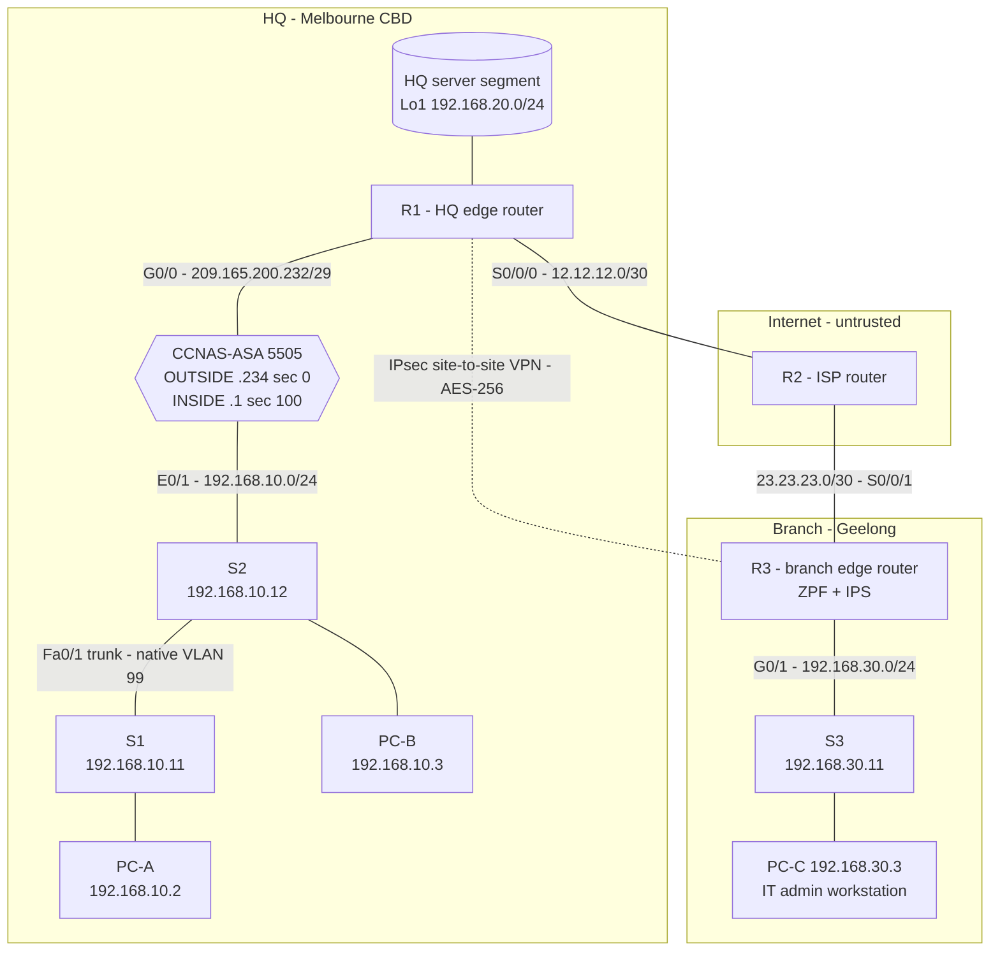
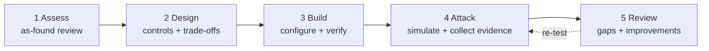
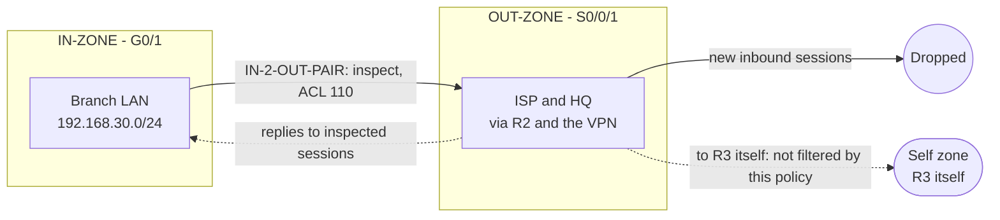
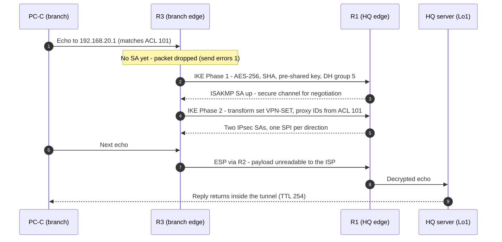
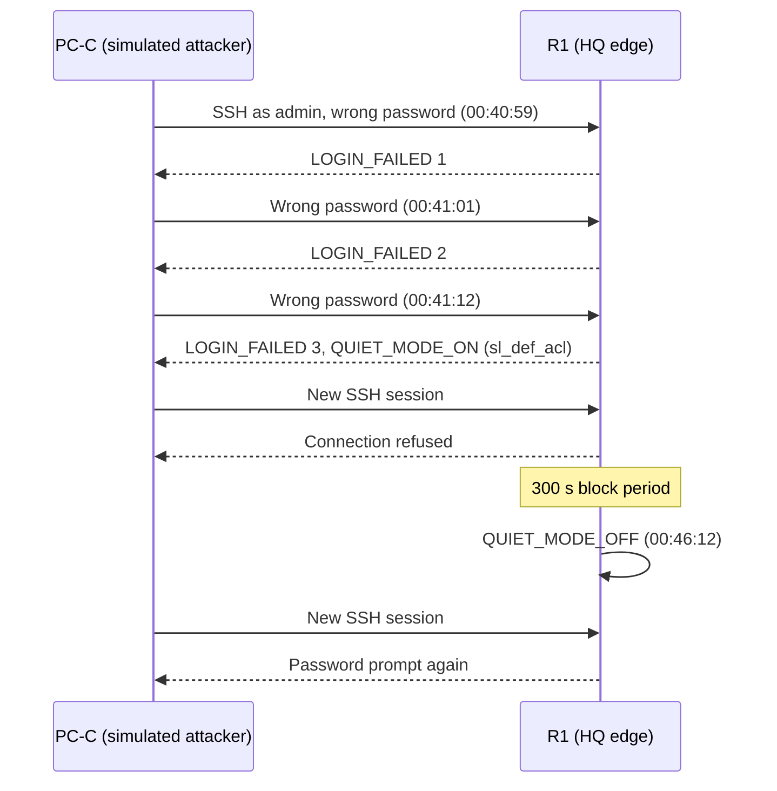
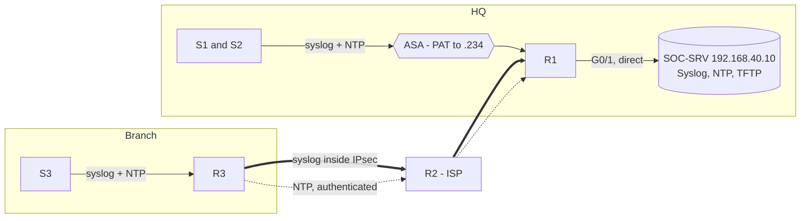

# Securing a Two-Site Network Perimeter - CCNA Capstone

*The company is made up, but the lab is real. Every config, output and log line in this note comes from my own Cisco Packet Tracer build, unless I've marked it **Illustrative**.*

> [!NOTE]
> **At a glance**
>
> - **The company (made up):** Redgum Accounting Group - a head office (HQ) in Melbourne CBD and a smaller branch in Geelong, about 30 staff. They store clients' tax file numbers (TFNs), so a leak would be a big deal.
> - **The problem:** the network was built to *work*, not to be *safe*. Anyone could get into the devices, traffic between the two offices wasn't encrypted, nothing filtered traffic at the branch, nothing watched for attacks, and there were no useful logs.
> - **What I did:** I checked the network and found 10 problems, planned a fix for each one, then built and secured 3 routers, 3 switches and an ASA 5505 firewall. Then I attacked my own build to check the fixes really worked.
> - **What happened:** password guessing over SSH got locked out after 3 tries (for 300 seconds, and every attempt was logged) · a flood of pings was blocked by the IPS (20 out of 20 dropped, each one alerted) · traffic between the offices was encrypted with AES-256 IPsec (I proved it three different ways) · the branch router now only lets in replies to conversations started from inside (testing the "block everything else" part is still on my re-test list).
> - **Then:** I reviewed my own work and found 11 gaps - including a VPN setting that real Cisco gear would reject, and logs stamped with the year 1993 - and wrote beginner-level CCNA fixes for each one.
> - **Short on time?** Jump to [section 10](#10-let-your-work-speak-before-you-do).

| Item | Detail |
|---|---|
| **Role** | Network security consultant (simulated engagement) |
| **Primary tool** | Cisco Packet Tracer - 1941 routers (securityk9 licence), 2960 switches, ASA 5505 |
| **Origin** | RMIT Certificate IV in Cyber Security (22334VIC), units VU21991 / ICTNWK509 - perimeter lab re-framed as a client engagement |
| **Disciplines** | CCNA routing and switching · Security+ · SOC detection · DFIR evidence handling |

> [!NOTE]
> **How to read this note**
>
> I'm a CCNA learner who is also studying cybersecurity, and I wrote this for other learners at the same stage. Whenever a new idea comes up, look for a **"What is...?"** box. It explains the idea in plain English, usually with an everyday comparison. If you already know it, just skip past it.

## Contents

- [1. Scenario](#1-scenario)
- [2. Approach](#2-approach)
- [3. Phase 1 - Assess](#3-phase-1---assess)
- [4. Phase 2 - Design](#4-phase-2---design)
- [5. Phase 3 - Build and harden](#5-phase-3---build-and-harden)
- [6. Phase 4 - Attack and verify](#6-phase-4---attack-and-verify)
- [7. Troubleshooting log](#7-troubleshooting-log)
- [8. Phase 5 - Review and improve](#8-phase-5---review-and-improve)
- [9. Security lens](#9-security-lens)
- [10. Let Your Work Speak Before You Do](#10-let-your-work-speak-before-you-do)
- [11. Skills demonstrated](#11-skills-demonstrated)
- [Appendix - Final configurations](#appendix---final-configurations)
- [References](#references)

---

## 1. Scenario

### The client

Redgum Accounting Group Pty Ltd is a made-up accounting and tax firm with two offices.

| | HQ - Melbourne CBD | Branch - Geelong |
|---|---|---|
| Staff | About 22 | About 8, including the firm's only IT Officer |
| What lives there | Staff LAN and the application server segment (practice management and tax software) | Staff LAN |
| Edge devices | R1 router + ASA 5505 firewall | R3 router |

Why does security matter so much for a firm like this? I used the CIA triad to think it through.

> [!TIP]
> **What is the CIA triad?**
>
> It's the three things security tries to protect: **Confidentiality** (only the right people can see the data), **Integrity** (nobody can secretly change it) and **Availability** (it's there when people need it). Think of a bank vault: only staff get in, nobody swaps the cash for fake notes, and it opens during business hours.

- **Confidentiality** - client TFNs, bank details and financial statements must stay private. Because Redgum handles TFNs, any breach involving TFN information falls under the Privacy Act's Notifiable Data Breaches (NDB) scheme, whatever the firm's turnover. In simple terms: if TFNs leak, the firm may have to report it to the regulator and tell the affected clients.
- **Integrity** - if someone changed figures or bank details, clients could lose real money.
- **Availability** - July to October is tax season, so the branch needs the HQ servers all day.

### Why Redgum engaged me

In this story, the firm's cyber-insurance renewal asked three questions nobody could answer "yes" to:

1. Is administrative access to network devices encrypted and individually authenticated?
2. Is data travelling between sites encrypted?
3. Can you detect attacks and produce logs to investigate them?

And when someone asked the IT Officer, "would we even know if someone tried?", nobody had an answer either. That question is really what this whole project is about.

### Scope and constraints

"Scope" just means what I'm allowed to work on.

- **In scope (mine to change):** R1, R3, S1-S3, the ASA and both WAN links.
- **Out of scope (not mine to touch):** the PCs themselves, the server operating systems, and R2 (it belongs to the ISP).
- **Constraints:** use the hardware the firm already owns (1941 routers with the securityk9 licence, 2960 switches, ASA 5505). There's no money yet for an AAA server (a central login server) or a SIEM (a system that collects and analyses logs).

### Device roles

Here's the part each lab device plays in the story:

| Lab device | Role in the scenario | Security job |
|---|---|---|
| R1 (1941) | HQ edge router | OSPF, VPN endpoint, protected management plane |
| CCNAS-ASA (5505) | HQ firewall | Stateful filtering, PAT, DHCP for staff |
| S1, S2 (2960) | HQ access switches | Staff LAN, hardened trunk |
| PC-A, PC-B | HQ staff workstations | - |
| R1 Loopback 1 | HQ application server segment (simulated) | The asset the branch needs to reach |
| R2 (1941) | ISP router - "the Internet" | Untrusted; the external attacker's vantage point |
| R3 (1941) | Branch edge router | Zone-based firewall, IPS, VPN endpoint |
| S3 (2960) | Branch switch | Branch LAN |
| PC-C | IT Officer's admin workstation | The only host allowed to manage the ASA |

### Topology

How to read it: solid lines are cables, and the dashed line between R1 and R3 is the VPN tunnel. The tunnel's traffic still physically travels through R2, but R2 can't read it.



### Addressing

| Device | Interface | IP address | Mask | Gateway |
|---|---|---|---|---|
| R1 | G0/0 | 209.165.200.233 | 255.255.255.248 | - |
| R1 | S0/0/0 (DCE) | 12.12.12.1 | 255.255.255.252 | - |
| R1 | Loopback 1 | 192.168.20.1 | 255.255.255.0 | - |
| R2 | S0/0/0 | 12.12.12.2 | 255.255.255.252 | - |
| R2 | S0/0/1 (DCE) | 23.23.23.2 | 255.255.255.252 | - |
| R3 | G0/1 | 192.168.30.1 | 255.255.255.0 | - |
| R3 | S0/0/1 | 23.23.23.1 | 255.255.255.252 | - |
| ASA | VLAN 1 - INSIDE (E0/1) | 192.168.10.1 | 255.255.255.0 | - |
| ASA | VLAN 2 - OUTSIDE (E0/0) | 209.165.200.234 | 255.255.255.248 | - |
| S1 | VLAN 1 | 192.168.10.11 | 255.255.255.0 | 192.168.10.1 |
| S2 | VLAN 1 | 192.168.10.12 | 255.255.255.0 | 192.168.10.1 |
| S3 | VLAN 1 | 192.168.30.11 | 255.255.255.0 | 192.168.30.1 |
| PC-A | NIC | 192.168.10.2 | 255.255.255.0 | 192.168.10.1 |
| PC-B | NIC | 192.168.10.3 | 255.255.255.0 | 192.168.10.1 |
| PC-C | NIC | 192.168.30.3 | 255.255.255.0 | 192.168.30.1 |

> [!TIP]
> **What do /24, /29 and /30 mean?**
>
> The number after the slash says how much of the address is the *network* part. Think of it like a street name (the network) and house numbers (the hosts): the bigger the slash number, the fewer houses on the street. A /30 has just 2 usable addresses - perfect for a link between two routers. A /29 has 6, and a /24 has 254.

> [!NOTE]
> **Lab simplifications (things I simplified on purpose)**
>
> - **R2 plays "the Internet".** In my lab, R2 runs OSPF with both offices, so it also learns Redgum's private routes. A real ISP would never carry private (RFC 1918) addresses like 192.168.x.x. In real life, each office would send everything to the ISP using a default route, and private traffic would only travel inside the VPN.
> - **The server segment is a loopback** (Lo1). A loopback is a virtual interface that is always up, which makes it a handy Packet Tracer trick for pretending a whole server subnet exists.
> - **Passwords and keys are lab values** from the Cisco training material. Never reuse them, and never publish real ones.

---

## 2. Approach



I treated this like a small real-world job: look at what's already there, plan the fixes (and what each one costs), build and check each one, attack the finished network, then review it as if someone else had built it.

To keep my testing and investigating focused, I used the **Alexiou Principle**. It's four questions that stop me from poking around randomly - like a detective deciding what they're asking before collecting clues:

1. What question am I trying to answer?
2. What data do I need to answer it?
3. How do I get that data?
4. What does the data tell me?

---

## 3. Phase 1 - Assess

**How I checked it:** I read every device's `show running-config` (its current settings), checked how the login lines and interfaces were set up, traced the path branch traffic takes to reach the HQ servers, and asked two questions about each part of the network: who can reach this, and what could they do with it?

| ID | Finding (as found) | What could go wrong | CIA | Severity |
|---|---|---|---|---|
| F-01 | Console and privileged EXEC unprotected on every router and switch | Anyone with a console cable owns the device | C I A | Critical |
| F-02 | No secure remote management - a console visit or cleartext Telnet were the only options | Credentials sniffed on the wire; slow incident response (the IT Officer drives between sites) | C A | High |
| F-03 | No individual accounts, no AAA, no privilege model | Shared access and zero accountability | C I | High |
| F-04 | No limit on login attempts (urgent the moment remote access is turned on) | Password guessing against the edge routers | C I | High |
| F-05 | Switch ports accept any device; unused ports are live | Rogue device or MAC flooding on the staff LAN | C I A | Medium |
| F-06 | S1-S2 trunk on defaults: DTP negotiation, native VLAN 1 | VLAN hopping (switch spoofing, double tagging) | C | Medium |
| F-07 | Branch-to-HQ server traffic crosses the ISP in cleartext | Interception or tampering in transit | C I | High |
| F-08 | Branch edge router has no firewall policy | Anyone upstream can start connections into the branch LAN | C I A | High |
| F-09 | No intrusion detection or prevention at the branch edge | Reconnaissance and attacks go unseen | C I A | Medium |
| F-10 | HQ ASA at factory defaults (outside interface on DHCP, no NAT or management policy) | No controlled, predictable path in or out of the staff LAN | C I A | High |

The CIA column shows which part of the CIA triad each problem puts at risk. Severity is my own judgement of how likely and how harmful each one is.

> [!TIP]
> **A lesson from F-04**
>
> Every fix can open a new door. Turning on SSH fixed F-02 (no secure remote access), but it also gave attackers a login prompt to guess passwords at - so brute-force protection had to go in at the same time.

---

## 4. Phase 2 - Design

For each problem I picked a control - a fix or a protection. The last column uses Security+ language: *technical* means it's done with technology (rather than a policy or a person), *preventive* means it stops something happening, and *detective* means it notices when something happens.

| Finding | Control | Device(s) | Security+ control type |
|---|---|---|---|
| F-01 | Enable secret, authenticated console and VTY, idle timeouts | All | Technical · Preventive |
| F-02 | SSH v2 only, Telnet disabled | Routers, ASA | Technical · Preventive |
| F-03 | Local AAA with a named admin account | Routers, ASA | Technical · Preventive (enables accountability) |
| F-04 | Login block, failure logging, minimum password length | Routers | Technical · Preventive + Detective |
| F-05 | Port security, unused ports shut | Switches | Technical · Preventive - planned here, built in Phase 5 |
| F-06 | Static trunk, DTP off, unused native VLAN 99 | S1, S2 | Technical · Preventive |
| F-07 | Site-to-site IPsec VPN | R1, R3 | Technical · Preventive |
| F-08 | Zone-Based Policy Firewall: inside-to-outside inspected, everything else dropped | R3 | Technical · Preventive |
| F-09 | IOS IPS inline on the WAN interface | R3 | Technical · Detective + Preventive |
| F-10 | ASA security levels, PAT, DHCP, restricted SSH, ICMP inspection | ASA | Technical · Preventive |

### Key decisions and trade-offs

A trade-off is what you give up to get something else. Here's what I chose, and why:

- **Zone-based firewall on R3, not a second ASA.** The branch router (a 1941 with the securityk9 licence) can already do firewalling, IPS and VPN. One box does it all, and the firm doesn't have to buy anything.
- **Site-to-site VPN, not remote-access VPN.** A site-to-site VPN connects two whole offices; a remote-access VPN connects one person's laptop. The whole branch needs HQ all day, so encrypting between the two routers means no VPN software on every PC.
- **Local AAA, not RADIUS or TACACS+.** RADIUS and TACACS+ are central login servers, and the firm doesn't have one yet. Local AAA (accounts stored on each device) still gives everyone a named login and a lockout. The downside I'm accepting: accounts live separately on every device, and there's no MFA (see the roadmap).
- **The IPS only checks incoming WAN traffic.** That's where untrusted traffic comes in, and checking just one direction stops a small router from working too hard.
- **PAT on the ASA.** It hides internal addresses and lets every staff PC share one outside address (more on PAT in 5.7).
- **ASA management from one PC only.** The IT Officer works from Geelong, so SSH to the ASA is allowed from PC-C and nowhere else. This is the idea of *least privilege*: give only the access that's actually needed.

---

## 5. Phase 3 - Build and harden

Order matters here. I built basic connectivity first (you can't test a security control on a network that doesn't route), then the switches, then device logins, then the branch's protection, then the VPN, and finally the HQ firewall.

> [!TIP]
> **What does "harden" mean?**
>
> Hardening means removing the easy ways in: changing defaults, adding passwords and turning off things you don't use. It's like securing a house - lock the doors, shut the windows you never open, and don't leave a key under the mat.

> [!NOTE]
> **How each control is written up**
>
> Each control follows the same pattern: **Finding → Decision → Config → Evidence → Why it matters for security.** The configs are written so you can paste them in after `configure terminal`. Lines starting with `!` are my comments explaining the why. Steps where the device asks you a question are shown with their prompts.

### 5.1 Foundation - addressing and OSPF

**Why first:** every later control (SSH, the firewall, the IPS and the VPN) depends on the routers being able to reach each other. Layer 3 (routing) has to work before you can secure it.

> [!TIP]
> **What is OSPF?**
>
> OSPF is a routing protocol: routers tell each other which networks they know about, and each router works out the best path. It's like a group of friends sharing one map - everyone adds the streets they know, then each person plans their own fastest route.

**Decision:** OSPFv2, process 1, single area 0. Interfaces facing a LAN or the ASA are passive: their networks are still advertised, but no hellos go out of them.

> [!TIP]
> **What is a passive interface?**
>
> OSPF routers find each other by sending small "hello" messages. A passive interface still puts its network on the shared map, but stops sending hellos out of that port, so nothing on that side can join the conversation. It's like putting your street on the map without inviting strangers on that street to help draw it.

```cisco
! ===== R1 =====
hostname R1
interface GigabitEthernet0/0
 ip address 209.165.200.233 255.255.255.248
 no shutdown
interface Serial0/0/0
 ip address 12.12.12.1 255.255.255.252
 no shutdown
interface Loopback1
 ip address 192.168.20.1 255.255.255.0
router ospf 1
 network 12.12.12.0 0.0.0.3 area 0
 network 192.168.20.0 0.0.0.255 area 0
 ! Added during troubleshooting (section 7) - advertises the ASA outside subnet
 network 209.165.200.232 0.0.0.7 area 0
 passive-interface GigabitEthernet0/0
```

```cisco
! ===== R2 (ISP) =====
hostname R2
interface Serial0/0/0
 ip address 12.12.12.2 255.255.255.252
 no shutdown
interface Serial0/0/1
 ip address 23.23.23.2 255.255.255.252
 no shutdown
router ospf 1
 network 12.12.12.0 0.0.0.3 area 0
 network 23.23.23.0 0.0.0.3 area 0
```

```cisco
! ===== R3 =====
hostname R3
interface GigabitEthernet0/1
 ip address 192.168.30.1 255.255.255.0
 no shutdown
interface Serial0/0/1
 ip address 23.23.23.1 255.255.255.252
 no shutdown
router ospf 1
 network 23.23.23.0 0.0.0.3 area 0
 network 192.168.30.0 0.0.0.255 area 0
 passive-interface GigabitEthernet0/1
```

**Evidence from my build**

- Pings between all three routers: `Success rate is 100 percent (5/5)` in every direction.
- PC-C to the HQ server segment (192.168.20.1): 4/4 replies at **TTL=253**. Keep that number in mind - it becomes important in [Test 3](#63-test-3---is-branch-to-hq-traffic-really-encrypted).

**Also worth checking:** `show ip ospf neighbor` (look for FULL, which means two routers have fully shared their maps) and `show ip route ospf` (the routes learned through OSPF).

> [!NOTE]
> **Why this matters for security**
>
> A passive interface means a rogue device plugged into the branch LAN can't make friends with R3 over OSPF and feed it fake routes (an attack called route poisoning). Share the map, but don't talk to strangers.

### 5.2 Switching layer - management and trunk security

**Finding:** F-06. Out of the box, a 2960 trunk negotiates with DTP and uses VLAN 1 as its native VLAN.

> [!TIP]
> **What are VLANs, trunks and the native VLAN?**
>
> A VLAN splits one physical switch into separate virtual networks - like separate floors in one building. A trunk is a link that carries traffic for many VLANs, like a lift that stops at every floor; each frame wears a floor badge (an 802.1Q tag) so the next switch knows where it belongs. The native VLAN is where frames *without* a badge end up.

> [!TIP]
> **What is DTP?**
>
> DTP (Dynamic Trunking Protocol) lets a switch port ask the device at the other end, "shall we be a trunk?", and set itself up automatically. Handy - but an attacker's laptop can answer "yes".

**Decision:** set the trunk manually, turn DTP off and move the native VLAN to an unused VLAN (99). I also gave each switch a management IP and default gateway, so it can be managed (and later send logs) across subnets.

```cisco
! ===== S1 (S2 is identical except the SVI address: 192.168.10.12) =====
hostname S1
interface FastEthernet0/1
 switchport mode trunk
 switchport trunk native vlan 99
 switchport nonegotiate
interface Vlan1
 ip address 192.168.10.11 255.255.255.0
 no shutdown
ip default-gateway 192.168.10.1
```

```cisco
! ===== S3 =====
hostname S3
interface Vlan1
 ip address 192.168.30.11 255.255.255.0
 no shutdown
ip default-gateway 192.168.30.1
```

**Evidence from my build:** `show interfaces trunk` on S1 and S2:

```text
Port        Mode         Encapsulation  Status        Native vlan
Fa0/1       on           802.1q         trunking      99

Port        Vlans allowed on trunk
Fa0/1       1-1005

Port        Vlans allowed and active in management domain
Fa0/1       1
```

> [!WARNING]
> **Spotted in review**
>
> The same output shows I never actually created VLAN 99, and the trunk still allows every VLAN from 1 to 1005. I fixed both in [Pack A](#81-pack-a---lock-down-the-access-layer).

> [!NOTE]
> **Why this matters for security**
>
> - **Switch spoofing:** if DTP is on, an attacker's laptop can pretend to be a switch, negotiate a trunk and see every VLAN - like getting into the lift that stops at every floor. Setting the trunk manually and adding `nonegotiate` switches that feature off.
> - **Double tagging:** the attacker hides a second badge under the first one. The first switch removes the outer badge, and the next switch reads the hidden one and delivers the frame to a VLAN the attacker shouldn't reach. It only works when the attacker's VLAN matches the trunk's native VLAN, so an unused native VLAN (99) breaks the trick.

### 5.3 Management plane - passwords, SSH, AAA and brute-force protection

**Findings:** F-01 to F-04.

> [!TIP]
> **What is the management plane?**
>
> It's everything you use to manage the device itself: logging in through the console cable or remotely, typing commands and changing settings. Think of it as a building's control room - whoever gets in there controls everything.

**Decision:** protect every way in (console, VTY and privileged EXEC) with hashed secrets; allow SSH v2 only; make people log in with a named local account through AAA; log out idle sessions; and slow down and log failed logins. I applied this to R1 and R3 (and to R2 in the lab, where I first practised it).

```cisco
! ===== R1 (R3 identical apart from the hostname) =====
hostname R1
! .internal was reserved by ICANN in 2024 for private networks
ip domain-name redgum.internal
!
! Hashed secrets: privileged EXEC plus a named admin account
enable secret ciscoenapa55
username admin privilege 15 secret ciscoenapa55
security passwords min-length 10
!
! AAA: every login is checked against the local user database
aaa new-model
aaa authentication login default local enable
!
! SSH v2 only - the RSA key pair needs the hostname and domain name above
! (interactive form: crypto key generate rsa, then 1024 at the prompt)
crypto key generate rsa general-keys modulus 1024
ip ssh version 2
!
line console 0
 exec-timeout 15 0
line vty 0 4
 transport input ssh
 exec-timeout 5 0
!
! Brute-force throttling: 3 failures within 30 s = no logins for 300 s
login block-for 300 attempts 3 within 30
login on-failure log
```

> [!NOTE]
> **Why no** `login local` **or line passwords?**
>
> This one confused me at first. Once `aaa new-model` is turned on, every line automatically uses the AAA `default` login method, so the per-line `login local` and line passwords in my first draft weren't needed any more. The `enable` at the end of the method list is only a backup for when the local user database can't be used at all - typing a wrong password does not fall through to it.

Cisco uses privilege levels from 0 to 15 to decide which commands someone can run - the higher the number, the more power:

| Level | What the user can do |
|---|---|
| 0 | `disable`, `enable`, `exit`, `help`, `logout` only |
| 1 | User EXEC - basic `show` and `ping` |
| 2-14 | Custom levels, built by assigning commands with `privilege exec level` |
| 15 | Privileged EXEC - everything (the `admin` account here) |

**Evidence from my build:** R1's running-config shows `transport input ssh`, `security passwords min-length 10` and `login on-failure log`, and PC-C gets an SSH password prompt from R1. [Test 1](#61-test-1---ssh-brute-force-against-r1) proves the lockout works.

**Also worth checking:** `show ip ssh` (it should say SSH is enabled, version 2.0) and `show login` (the lockout settings, and whether the router is blocking logins right now).

> [!NOTE]
> **Why this matters for security**
>
> - **AAA:** Authentication (who are you?), Authorisation (what are you allowed to do?) and Accounting (what did you do?) - like showing ID at the front desk, the rooms your key card opens, and the visitor log. This build covers authentication. Accounting stays weak until Phase 5 adds central logging.
> - **Secret vs password:** `secret` stores a hash; `password` stores plaintext, or reversible Type 7 at best. A hash is like a fingerprint of your password: the router can check it, but nobody can turn it back into the password. Type 7 is more like a simple code that anyone who knows the trick can undo. Always use `secret`.
> - **Telnet vs SSH:** Telnet sends your password in cleartext, like writing it on a postcard - anyone handling it can read it (ATT&CK T1040, Network Sniffing). SSH is a sealed envelope.
> - **Login block:** like a phone that locks for a while after too many wrong PINs. It turns an online guessing attack from thousands of tries per minute into 3 tries per 5 minutes.

### 5.4 Branch perimeter - Zone-Based Policy Firewall on R3

> [!TIP]
> **Before you start - the securityk9 licence on R1 and R3**
>
> ZPF, IPS and IPsec are all part of the router's security feature pack, which has to be switched on with a licence first (and needs a reload). Both running-configs in my build show the licence line.
> ```cisco
> R3(config)# license boot module c1900 technology-package securityk9
> ACCEPT? [yes/no]: yes
> R3(config)# end
> R3# copy running-config startup-config
> R3# reload
> ```

**Finding:** F-08. Anything on the internet side of R3 could open a connection straight into the branch LAN.

> [!TIP]
> **What are zones and a stateful firewall?**
>
> A zone is a group of interfaces with the same trust level - here, IN-ZONE (the branch LAN) and OUT-ZONE (towards the internet). A stateful firewall remembers who started each conversation. Picture a receptionist who knows you rang the plumber, so when the plumber calls back they're put straight through - but random callers aren't.

**Decision:** two zones, one direction. Traffic from the branch LAN going out is inspected (that's the stateful part), so the replies are allowed back in automatically. There's no rule letting the outside start a conversation inwards, so new inbound sessions are dropped by default. I chose ZPF over plain ACLs because it's stateful, it blocks traffic between zones by default, and the policy reads almost like a sentence.



```cisco
! ===== R3 =====
zone security IN-ZONE
zone security OUT-ZONE
!
! What counts as "internal" traffic
access-list 110 permit ip 192.168.30.0 0.0.0.255 any
access-list 110 deny ip any any
!
class-map type inspect match-all INTERNAL-CLASS-MAP
 match access-group 110
!
policy-map type inspect IN-2-OUT-PMAP
 class type inspect INTERNAL-CLASS-MAP
  inspect
!
zone-pair security IN-2-OUT-PAIR source IN-ZONE destination OUT-ZONE
 service-policy type inspect IN-2-OUT-PMAP
!
interface GigabitEthernet0/1
 zone-member security IN-ZONE
interface Serial0/0/1
 zone-member security OUT-ZONE
```

**Evidence from my build:** `show policy-map type inspect zone-pair sessions` while PC-C pinged the HQ server (excerpt):

```text
policy exists on zp IN-2-OUT-PAIR
 Zone-pair: IN-2-OUT-PAIR
  Service-policy inspect : IN-2-OUT-PMAP
    Class-map: INTERNAL-CLASS-MAP (match-all)
      Match: access-group 110
      Inspect
        Number of Established Sessions = 1
        Established Sessions
         Session 2817981888 (192.168.30.3:25)=>(192.168.20.1:0) icmp SIS_OPEN
    Class-map: class-default (match-any)
      Match: any
      Drop (default action)
        0 packets, 0 bytes
```

PC-C's ping created a tracked session (`SIS_OPEN`). That entry in the firewall's memory is what lets the replies back in. Anything that doesn't match ACL 110 falls into `class-default` and gets dropped.

> [!NOTE]
> **Design consequences**
>
> - **No OUT-2-IN pair** means HQ can't *start* a connection into the branch, not even through the VPN, because traffic that comes out of the tunnel still arrives on the OUT-ZONE interface. That's fine for Redgum, because the branch pulls data from HQ, not the other way round. If HQ ever needed to push something, I'd add a narrow OUT-2-IN rule.
> - **The self zone** (traffic to and from R3 itself) isn't covered by this policy - it's like mail addressed to the security guard rather than to a tenant. So R3's own logins need their own protection: 5.3 now, plus the management ACL in Phase 5.

> [!NOTE]
> **Why this matters for security**
>
> - **Stateful vs stateless:** a stateless ACL judges every packet on its own, with no memory. A stateful firewall remembers who started the conversation.
> - **Implicit deny between zones:** if no rule allows it, it's blocked. This "default deny" approach is the safest starting point.
> - **Zones are segmentation** (Security+ calls them "security zones"): trust depends on where traffic comes from, not just on its IP address.

### 5.5 Branch perimeter - IOS IPS on R3

**Finding:** F-09. Nothing watched for, or blocked, hostile traffic arriving at the branch.

> [!TIP]
> **IDS vs IPS - what's the difference?**
>
> An IDS (intrusion detection system) watches traffic and raises an alert. An IPS (intrusion prevention system) sits in the path of the traffic, so it can also block it. Think smoke alarm versus sprinkler: one makes noise, the other actually does something about it.

**Decision:** Cisco IOS IPS, checking traffic coming in on S0/0/1 (the WAN side). It's signature-based, which means it looks for known attack patterns. I started small on purpose: retire (switch off) every signature group, switch the `ios_ips basic` group back on, then enable signature 2004 (ICMP Echo Request - the message a normal ping sends) with **alert + drop**. The goal is to make the branch invisible to ping sweeps (an attacker pinging a whole range of addresses to see who answers - like knocking on every door in a street to see who's home) and to stop ping floods at the door. Packet Tracer already keeps the signature files in flash, so I didn't need to import a key.

```text
R3# mkdir ipsdir
Create directory filename [ipsdir]? <Enter>
R3# configure terminal
R3(config)# ip ips config location flash:ipsdir
R3(config)# ip ips name IPS-RULE
R3(config)# ip ips signature-category
R3(config-ips-category)# category all
R3(config-ips-category-action)# retired true
R3(config-ips-category-action)# exit
R3(config-ips-category)# category ios_ips basic
R3(config-ips-category-action)# retired false
R3(config-ips-category-action)# exit
R3(config-ips-category)# exit
Do you want to accept these changes? [confirm] <Enter>
R3(config)# interface Serial0/0/1
R3(config-if)# ip ips IPS-RULE in
R3(config-if)# exit
R3(config)# ip ips signature-definition
R3(config-sigdef)# signature 2004 0
R3(config-sigdef-sig)# status
R3(config-sigdef-sig-status)# retired false
R3(config-sigdef-sig-status)# enabled true
R3(config-sigdef-sig-status)# exit
R3(config-sigdef-sig)# engine
R3(config-sigdef-sig-engine)# event-action produce-alert
R3(config-sigdef-sig-engine)# event-action deny-packet-inline
R3(config-sigdef-sig-engine)# exit
R3(config-sigdef-sig)# exit
R3(config-sigdef)# exit
Do you want to accept these changes? [confirm] <Enter>
```

**Evidence from my build:** `show ip ips all` (excerpt):

```text
IPS Signature File Configuration Status
    Configured Config Locations: flash:ipsdir
IPS Syslog and SDEE Notification Status
    Event notification through syslog is enabled
    Event notification through SDEE is enabled
IPS Signature Status
    Total Active Signatures: 1
IPS Packet Scanning and Interface Status
    IPS Rule Configuration
      IPS name IPS-RULE
    IPS fail closed is disabled
    Interface Configuration
      Interface Serial0/0/1
        Inbound IPS rule is IPS-RULE
IPS Category CLI Configuration:
    Category all
        Retire: True
    Category ios_ips basic
        Retire: False
```

> [!NOTE]
> **Why this matters for security**
>
> - **Signature-based** detection looks for known patterns - like a bouncer with photos of people who are banned. **Anomaly-based** detection flags anything unusual compared with normal behaviour - like a bouncer who notices someone acting strangely.
> - **IPS vs IDS:** this IPS sits inline (in the path), so it can drop packets (`deny-packet-inline`). An IDS can only alert.
> - **Fail-open vs fail-closed:** `IPS fail closed is disabled` means fail-open: if the IPS engine breaks, traffic keeps flowing without being checked. Think of an electronic door lock in a power cut - fail-open unlocks so people can still move around; fail-closed stays locked. Here availability wins over security. That's reasonable for a branch during tax season, but it should be a written-down decision, not a default nobody noticed.
> - **Tuning:** blocking every ping also stops ping-based monitoring tools from checking that R3 is alive. A SOC would tune this - adjusting the rules so they block attacks without breaking normal work.

### 5.6 Site-to-site IPsec VPN between R1 and R3

**Finding:** F-07. Branch staff reached the HQ servers across the ISP in cleartext, so anyone on the path could read the traffic.

> [!TIP]
> **What are a VPN and IPsec?**
>
> A VPN builds a private, encrypted tunnel across a network you don't trust. IPsec is the set of protocols doing the encrypting and checking here. It's like putting your letters in a locked box before handing them to the public post: the postie still carries them, but can't read them.

**Decision:** a site-to-site IPsec tunnel between R1 and R3, set up with a crypto map using IKEv1 (also called ISAKMP). "Interesting traffic" - the traffic that should go through the tunnel - is the HQ server segment talking to the branch LAN (ACL 101).

> [!TIP]
> **What are IKE Phase 1 and Phase 2?**
>
> The tunnel is built in two steps. In **Phase 1**, the two routers prove who they are and build a safe channel to talk in - like two people stepping into a private room and agreeing on a secret language. In **Phase 2**, they use that room to agree on how to pack and lock the actual data. These agreements are called SAs (security associations). Phase 2 creates two of them, one for each direction, and each gets an ID number called an SPI.

| | Phase 1 - IKE (ISAKMP SA) | Phase 2 - IPsec SAs |
|---|---|---|
| **Purpose** | Build an authenticated, encrypted channel to negotiate in | Build the tunnels that carry the data |
| **Negotiated here** | AES-256, SHA, pre-shared key, DH group 5, lifetime 3600 s | Transform set VPN-SET (ESP AES-256 + ESP SHA-HMAC), PFS group 5, proxy IDs from ACL 101 |
| **Result** | One bidirectional ISAKMP SA | Two one-way IPsec SAs, each with its own SPI |
| **Verify with** | `show crypto isakmp sa` | `show crypto ipsec sa` |



```cisco
! ===== R1 (licence prerequisite: see 5.4) =====
! Interesting traffic: HQ server segment <-> branch LAN
access-list 101 permit ip 192.168.20.0 0.0.0.255 192.168.30.0 0.0.0.255
!
! Phase 1
crypto isakmp policy 10
 encryption aes 256
 hash sha
 authentication pre-share
 group 5
 lifetime 3600
crypto isakmp key ciscovpnpa55 address 23.23.23.1
!
! Phase 2
crypto ipsec transform-set VPN-SET esp-aes 256 esp-sha-hmac
crypto map CMAP 10 ipsec-isakmp
 set peer 23.23.23.1
 set pfs group5
 set transform-set VPN-SET
 match address 101
!
interface Serial0/0/0
 crypto map CMAP
```

```cisco
! ===== R3 - as built =====
access-list 101 permit ip 192.168.30.0 0.0.0.255 192.168.20.0 0.0.0.255
crypto isakmp policy 10
 encryption aes 256
 hash sha
 authentication pre-share
 group 5
 lifetime 3600
crypto isakmp key ciscovpnpa55 address 12.12.12.1
crypto ipsec transform-set VPN-SET esp-aes 256 esp-sha-hmac
crypto map CMAP 10 ipsec-isakmp
 set peer 12.12.12.1
 set transform-set VPN-SET
 match address 101
interface Serial0/0/1
 crypto map CMAP
```

> [!WARNING]
> **Spotted in review - R3 is not a mirror of R1**
>
> R3's crypto map is missing `set pfs group5`. On real Cisco IOS, a router that has PFS turned on insists on it for incoming requests - so when R3 starts the tunnel without PFS, Phase 2 fails. Packet Tracer let it through anyway. I fixed it in [Pack C](#83-pack-c---fix-the-vpn-drift).

**Evidence from my build:** PC-C's ping to 192.168.20.1 lost the first packet, then got 3 replies at TTL=254. Here's `show crypto ipsec sa` on R1 (excerpt):

```text
interface: Serial0/0/0
    Crypto map tag: CMAP, local addr 12.12.12.1
   local  ident (addr/mask/prot/port): (192.168.20.0/255.255.255.0/0/0)
   remote ident (addr/mask/prot/port): (192.168.30.0/255.255.255.0/0/0)
   current_peer 23.23.23.1 port 500
    #pkts encaps: 3, #pkts encrypt: 3, #pkts digest: 0
    #pkts decaps: 3, #pkts decrypt: 3, #pkts verify: 0
    #send errors 0, #recv errors 0
     inbound esp sas:
      spi: 0xE1EEF96F(3790535023)
        transform: esp-aes 256 esp-sha-hmac ,
        in use settings ={Tunnel, }
        Status: ACTIVE
     outbound esp sas:
      spi: 0x28A54D34(681921844)
```

R3 shows the mirror image, with one difference that matters: `#send errors 1`. I explain what that means in [Test 3](#63-test-3---is-branch-to-hq-traffic-really-encrypted).

> [!NOTE]
> **Why this matters for security - which piece does which job**
>
>
> | Goal | Mechanism in this tunnel |
> |---|---|
> | Confidentiality | AES-256 (symmetric encryption) |
> | Integrity and origin | HMAC-SHA (`esp-sha-hmac`) |
> | Peer authentication | Pre-shared key (certificates scale better) |
> | Key exchange over an untrusted path | Diffie-Hellman group 5 |
> | Old sessions stay safe if a key leaks | PFS - a fresh DH exchange for Phase 2 keys |
> | Whole original packet protected | ESP in tunnel mode (new outer IP header) |
>
> **Is this crypto still current?** RFC 8247 (the IETF's guidance for IKEv2) rates DH group 5 as SHOULD NOT and HMAC-SHA1 as MUST- (still allowed, but on its way out). The lab brief used both. For a real network I'd use IKEv2, DH group 14 or 19+, SHA-256 or better, and a long random key or certificates.

> [!TIP]
> **What are Diffie-Hellman and PFS?**
>
> Diffie-Hellman (DH) lets two routers end up with the same secret key without ever sending the key itself. The classic picture is two people each mixing a secret paint colour into a shared colour and swapping the results - both end up with the same final colour, but anyone watching can't un-mix it. PFS (perfect forward secrecy) means a fresh DH exchange for each new set of keys, so one stolen key only unlocks one session, not every session before it.

### 5.7 HQ perimeter - ASA 5505

**Finding:** F-10. The ASA was still on its factory settings.

**Decisions:**

- Two VLAN interfaces with security levels: INSIDE = 100 (fully trusted) and OUTSIDE = 0 (not trusted). Out of the box, a 5505 puts port E0/0 in VLAN 2 and E0/1 in VLAN 1.
- A fixed (static) outside address instead of one from DHCP, so routing and rules always point at the same address.
- SSH only, checked against the ASA's local user list, only from PC-C, with a 10-minute timeout.
- DHCP gives staff PCs addresses from .5 to .30, skipping the addresses already used by the gateway, switches and static PCs.
- A default route to R1, PAT for the whole staff LAN, and ICMP inspection so staff pings get their replies.

> [!TIP]
> **What are NAT and PAT?**
>
> NAT swaps private addresses for public ones at the edge of the network. PAT is the many-to-one version: every staff PC shares the ASA's single outside address, and the ASA uses port numbers to remember which reply belongs to which PC. It's like an office switchboard - everyone shares one public phone number, and the receptionist knows which extension each call belongs to.

```cisco
! ===== CCNAS-ASA =====
interface Vlan1
 nameif INSIDE
 security-level 100
 ip address 192.168.10.1 255.255.255.0
interface Vlan2
 nameif OUTSIDE
 security-level 0
 no ip address dhcp
 ip address 209.165.200.234 255.255.255.248
!
hostname CCNAS-ASA
domain-name redgum.internal
enable password ciscoenapa55
!
! Management: local AAA, SSH from the IT Officer's workstation only
username admin password adminpa55
aaa authentication ssh console LOCAL
crypto key generate rsa modulus 1024
ssh 192.168.30.3 255.255.255.255 OUTSIDE
ssh timeout 10
!
dhcpd address 192.168.10.5-192.168.10.30 INSIDE
dhcpd enable INSIDE
!
route OUTSIDE 0.0.0.0 0.0.0.0 209.165.200.233
!
! PAT: the whole staff LAN shares the outside interface address
object network INSIDE-NET
 subnet 192.168.10.0 255.255.255.0
 nat (INSIDE,OUTSIDE) dynamic interface
!
! Stateful ICMP: replies to pings that staff start are allowed back in
class-map inspection_default
 match default-inspection-traffic
policy-map global-policy
 class inspection_default
  inspect icmp
service-policy global-policy global
```

> [!NOTE]
> **Gap in my original write-up**
>
> My original notes skipped the step that creates the ASA's RSA keys. SSH can't work without a key pair, so I've included it here (check it with `show crypto key mypubkey rsa`).

**Evidence from my build:** after the OSPF fix in section 7, PC-C opened an SSH session to the ASA at 209.165.200.234 - the only source the ASA accepts for SSH.

**Also worth checking:** `show route`, `show xlate` (after PC-A pings out, this shows the PAT translations) and `show dhcpd binding`.

> [!NOTE]
> **Why this matters for security**
>
> - **Security levels are trust levels:** traffic going from 100 down to 0 is allowed and tracked; traffic going from 0 up to 100 is blocked unless an ACL allows it. Think of water: it flows downhill on its own, but needs a pump to go uphill.
> - **NAT is not a firewall rule**, but with PAT, outsiders have no direct way to reach a staff PC unless that PC started the conversation. It adds a layer of protection (defence in depth - like having a fence, a locked door *and* an alarm), but it doesn't replace proper rules.
> - **ICMP inspection** (`inspect icmp`) lets the replies come back without opening ICMP to everyone outside.
> - On the ASA, `enable password` is stored as a hash - unlike IOS, where you need `enable secret` for that.

---

## 6. Phase 4 - Attack and verify

Next, I attacked my own build. Each test answers one question, using the Alexiou Principle from section 2.

> [!WARNING]
> **Lab only**
>
> I ran these attacks against my own Packet Tracer lab. Never test systems you don't own or don't have written permission to test - unauthorised testing can be a crime.

> [!TIP]
> **What is MITRE ATT&CK?**
>
> It's a free catalogue of real attacker techniques, each with an ID such as T1110.001. Think of it as a dictionary of attacker "moves", so defenders everywhere can describe an attack in the same language.

| # | Question | Simulated technique (ATT&CK) | Expected | Result |
|---|---|---|---|---|
| T1 | Can someone guess R1's admin password over SSH? | Password guessing (T1110.001) from PC-C | Lockout after 3 failures, logged | **PASS** |
| T2 | Can the Internet side sweep or flood the branch edge with ICMP? | ICMP flood (T1498.001) / sweep (T1595.001) from R2 | Dropped inline, alerted | **PASS** |
| T3 | Is branch-to-HQ server traffic really encrypted? | Interception on the ISP path (T1040) | ESP-encapsulated, counters rising | **PASS** |
| T4 | Can the outside start a session into the branch LAN? | Unsolicited inbound connection | Dropped by the ZPF | Not tested in the original build - on the re-test list |

### 6.1 Test 1 - SSH brute force against R1

> [!TIP]
> **What is a brute-force attack?**
>
> It's guessing passwords over and over until one works - like trying every key on a giant key ring. Against a live login prompt, the device can fight back by slowing the attacker down, which is exactly what the login block does.

1. **Question:** if an attacker gets onto a branch PC and tries to guess R1's admin password, does R1 stop them - and would we even know?
2. **Data:** R1's `SEC_LOGIN` log messages, and what PC-C sees on screen.
3. **How:** I ran `ssh -l admin 12.12.12.1` from PC-C and typed wrong passwords while watching R1's log. The lab brief asked for a Telnet test, but Telnet is switched off (`transport input ssh`), so SSH was the realistic way in.
4. **What it told me:**

```text
%SEC_LOGIN-5-LOGIN_FAILED: Login failed [user: admin] [Source: 192.168.30.3] [localport: 22] [Reason: Login Authentication Failed] at 00:40:59 UTC Tue Mar 2 1993
%SEC_LOGIN-5-LOGIN_FAILED: Login failed [user: admin] [Source: 192.168.30.3] [localport: 22] [Reason: Login Authentication Failed] at 00:41:01 UTC Tue Mar 2 1993
%SEC_LOGIN-5-LOGIN_FAILED: Login failed [user: admin] [Source: 192.168.30.3] [localport: 22] [Reason: Login Authentication Failed] at 00:41:12 UTC Tue Mar 2 1993
%SEC_LOGIN-1-QUIET_MODE_ON: Still timeleft for watching failures is 0 secs, [user: admin] [Source: 192.168.30.3] [localport: 22] [Reason: Login Authentication Failed] [ACL: sl_def_acl] at 00:41:12 UTC Tue Mar 2 1993
%SEC_LOGIN-5-QUIET_MODE_OFF: Quiet Mode is OFF, because block period timed out at 00:46:12 UTC Tue Mar 2 1993
```

- **3 failures in 13 seconds** (00:40:59 to 00:41:12), all from the same source, 192.168.30.3, against the same account, `admin`, on port 22 (SSH).
- The third failure switched on "quiet mode" (the lockout), logged at **severity 1 (alert)** - the router's way of saying "look at this now".
- While quiet mode was on, PC-C got `% Connection refused by remote host`. R1 had automatically built an ACL called `sl_def_acl` that blocks Telnet, HTTP and SSH.
- Quiet mode switched off at 00:46:12 - **exactly 300 seconds** later - and the next attempt got a password prompt again.



> [!TIP]
> **Analyst notes**
>
> - **Why PC-C?** It's the worst case. PC-C is the admin's PC, and after Phase 5 it's the only PC allowed to reach the login prompt at all. Security people call this "assume breach": plan as if an attacker is already inside - for example, after a phishing email lands on that exact PC.
> - **The attacker guessed the username `admin`.** A default-looking username gives away half of the login. A less obvious admin username makes guessing harder.
> - **Two gaps in the evidence:** the timestamps say 1993 (the router's clock was never set), and only *failed* logins are logged - if the fourth guess had worked, R1 would have said nothing. I fixed both in [Pack B](#82-pack-b---finish-the-management-plane-baseline) and [Pack D](#84-pack-d---make-the-logs-forensically-useful).

### 6.2 Test 2 - ICMP flood against the branch edge

1. **Question:** can someone on the internet side sweep or flood R3 with pings - and does the IPS see it?
2. **Data:** R2's ping results and R3's IPS alerts.
3. **How:** an extended ping from R2 to 23.23.23.1 with a repeat count of 20. (`ping -t` is a Windows option - Cisco IOS doesn't have it.)
4. **What it told me:** R2 reported `Success rate is 0 percent (0/20)`, and R3 logged one alert per packet:

```text
%IPS-4-SIGNATURE: Sig:2004 Subsig:0 Sev:25  [23.23.23.2 -> 23.23.23.1:0] RiskRating:25
%IPS-4-SIGNATURE: Sig:2004 Subsig:0 Sev:25  [23.23.23.2 -> 23.23.23.1:0] RiskRating:25
%IPS-4-SIGNATURE: Sig:2004 Subsig:0 Sev:25  [23.23.23.2 -> 23.23.23.1:0] RiskRating:25
(one line per echo request)
```

- Signature 2004 is ICMP Echo Request - a normal ping. The source was 23.23.23.2 (the ISP side), and the target was R3's WAN address.
- RiskRating 25 is low on Cisco's 0-100 scale. One alert on its own is just noise; twenty in a few seconds from the same source is a pattern worth a ticket.
- Earlier, a ping from R2 to the branch gateway (192.168.30.1) was dropped with the same alert, so the IPS covers anything coming in through R3's WAN interface.

> [!IMPORTANT]
> **What this test does and doesn't prove**
>
> Signature 2004 fires on **every** ping, so this proves the IPS blocks ping-based scanning - not that it protects against a big flood (a denial-of-service, or DoS, attack, which tries to overwhelm something so real users can't use it). One ping or a million, the IPS treats each packet the same way, and a real flood would fill the internet link before R3 even saw it. It's the difference between hanging up on one prank caller and your phone line being jammed by thousands of calls at once. Real DoS protection happens further upstream (the ISP's DDoS protection) and through rate limiting.

### 6.3 Test 3 - Is branch-to-HQ traffic really encrypted

1. **Question:** is branch-to-HQ server traffic really encrypted across the ISP, or just routed normally?
2. **Data:** PC-C's ping output, `show crypto ipsec sa` on both routers, and the reply TTLs from before and after the VPN.
3. **How:** I pinged 192.168.20.1 from PC-C to create interesting traffic, then read the SAs on R1 and R3.
4. **What it told me:** six observations from three different sources, all pointing the same way.

| # | Observation | Source | What it means |
|---|---|---|---|
| 1 | First reply "Request timed out", then 3 replies (25 % loss) | PC-C | The first packet triggered IKE and was dropped while the tunnel was built |
| 2 | `#send errors 1` on R3 only | R3 | That one dropped packet - R3 (the branch) started the tunnel |
| 3 | `#pkts encaps: 3` and `#pkts decaps: 3` on both peers | R1, R3 | The 3 successful echo/reply pairs travelled inside ESP |
| 4 | R1 inbound SPI 0xE1EEF96F = R3 outbound SPI; R1 outbound SPI 0x28A54D34 = R3 inbound SPI | R1, R3 | Two one-way SAs, mirrored on both peers |
| 5 | `esp-aes 256 esp-sha-hmac`, `in use settings ={Tunnel, }`, `Status: ACTIVE` | R1, R3 | AES-256 confidentiality, HMAC-SHA integrity, whole original packet encapsulated |
| 6 | Reply TTL 253 before the VPN, 254 after | PC-C | The inner packet no longer "sees" R2 - encapsulation visible from the endpoint |

> [!TIP]
> **What is TTL?**
>
> TTL (time to live) is a countdown number inside every packet. Each router the packet passes through takes 1 off, and if it reaches zero the packet is thrown away - that stops packets looping around forever. So the TTL you receive tells you how many routers the packet went through.

> [!NOTE]
> **Why the TTL went up by one**
>
> This was my favourite discovery in the whole project. R1 sends its reply with TTL 255. **Before the VPN**, R2 and R3 each take 1 off, so PC-C sees 253. **After the VPN**, R1 puts the reply inside a new ESP packet - a new envelope with new addresses on it - and R2 only changes the TTL on the outside envelope. R3 opens the envelope and forwards the original packet (its TTL is still 255), taking 1 off, so PC-C sees 254. R2 has become invisible to the packet inside, which is exactly what tunnel mode is supposed to do.

> [!NOTE]
> **Packet Tracer quirks**
>
> - `#pkts digest` and `#pkts verify` stay at 0, and the SA shows `replay detection support: N`, even with `esp-sha-hmac` set. On real IOS those counters go up as the integrity checks happen, so don't read 0 as "no integrity" in Packet Tracer.
> - **How to see it with the course tool:** in Simulation mode, follow the packet across the R1-R2 link and compare its layers with the same ping before the VPN.
> - **Side note:** Wireshark on an emulated link (GNS3 or Cisco CML) shows ESP packets with SPIs and sequence numbers, and a payload you can't read.

### 6.4 Test 4 - Does the ZPF block unsolicited inbound traffic

I didn't run this one in the original build. The session table proves the firewall tracks conversations started from inside; it doesn't prove that conversations started from outside get dropped. A control you haven't tested is a control you're only *hoping* works. It's item 8 on the [re-test checklist](#85-re-test-checklist).

---

## 7. Troubleshooting log

This was the most useful mistake I made in the whole project.

**Symptom:** PC-C couldn't SSH to the ASA at 209.165.200.234, even though the ASA allowed SSH from 192.168.30.3.

1. **Question:** is the ASA refusing me, or is my traffic never getting there?
2. **Data:** whether each hop on the path can be reached, and R1's OSPF settings.
3. **How:** I pinged R1's ASA-facing interface (209.165.200.233) from PC-C - it failed, so the ASA wasn't the problem. Then `show ip ospf interface` on R1 showed that G0/0's subnet wasn't part of OSPF.
4. **Root cause:** 209.165.200.232/29 was never advertised, so R3 had no route to the ASA's outside subnet. My traffic was being dropped long before it got anywhere near the firewall.

**Fix:**

```cisco
! ===== R1 =====
router ospf 1
 network 209.165.200.232 0.0.0.7 area 0
```

G0/0 stays passive. SSH from PC-C to the ASA worked on the next try.

> [!TIP]
> **Lessons**
>
> - Check the layers from the bottom up before blaming a security control. A missing route can look exactly like a firewall block.
> - `passive-interface` stops OSPF hellos, but it doesn't advertise anything by itself - the subnet still needs a `network` statement.
> - A faster clue for next time: `show ip route` on R3 would have shown there was no route to 209.165.200.232/29.

---

## 8. Phase 5 - Review and improve

Once everything worked, I went back through every running-config, log and screenshot as if someone else had built it. A control that only exists in the plan isn't really a control.

I've written every fix below, but I won't call any of them done until they pass the [re-test checklist](#85-re-test-checklist).

| ID | Gap found in review | Evidence | Risk | Fix |
|---|---|---|---|---|
| G-01 | Port security was planned (F-05) but never configured | No port-security lines on S1-S3 | Rogue device on the staff LAN | Pack A |
| G-02 | Native VLAN 99 never created; trunk allows VLANs 1-1005 | `show interfaces trunk` | Future VLANs cross the trunk automatically | Pack A |
| G-03 | Switches never hardened (the plan said routers *and* switches) | Switch configs hold only hostname, trunk and SVI | Unauthenticated access to switches | Pack A |
| G-04 | `no service password-encryption` on every device | Running-configs | Any line password readable in configs and backups | Pack B |
| G-05 | VTY 5-15 left at defaults; any source can reach the login prompt | R1: `line vty 5 15` empty, no `access-class` | More open lines and a bigger attack surface | Pack B |
| G-06 | Only failed logins are logged | `login on-failure log` only | A successful brute force would be invisible | Pack B |
| G-07 | CDP on ISP-facing links, no warning banner, 1024-bit RSA keys | Running-configs | Reconnaissance, weaker legal footing, below current key-size minimum | Pack B |
| G-08 | VPN peers not mirrored: R3 lacks `set pfs group5` | R1 vs R3 crypto maps | Real IOS rejects Phase 2 when R3 initiates | Pack C |
| G-09 | Clock at 1993, no timestamps, logs only in router RAM | Log lines; `no service timestamps` | Useless timeline; evidence lost on reload or wiped by an intruder | Pack D |
| G-10 | No off-box configuration baseline | Only startup-config exists | Nothing to diff against after an incident | Pack D |
| G-11 | ZPF deny path never tested | Test log | Untested control | 8.5 item 8 |

### 8.1 Pack A - Lock down the access layer

**Fixes:** G-01, G-02, G-03.

**Decision:** port security on every user port (one "sticky" MAC address, `restrict` mode), BPDU guard to stop rogue switches, every unused port shut down and moved into a "black-hole" VLAN (an unused VLAN that goes nowhere - like moving empty rooms to a floor the lift doesn't stop at), VLAN 99 actually created, the trunk limited to only the VLANs it needs, and the same login protection the routers have.

> [!TIP]
> **What are port security, sticky MACs and BPDU guard?**
>
> Every network card has a MAC address, a bit like a serial number. Port security lets a switch port accept only a set number of MAC addresses. "Sticky" means the port learns the first device it sees and remembers it - like a lock that learns the first key used in it and refuses every other key. BPDU guard shuts a port down if someone plugs a switch into it, because only switches send BPDUs (spanning tree messages).

> [!NOTE]
> **Port numbers are assumed**
>
> My original build notes only recorded the S1-S2 trunk on Fa0/1, so I've assumed the other ports below. Change them to match your own cabling.

| Switch | Port | Connects to | Mode |
|---|---|---|---|
| S1 | Fa0/1 | S2 Fa0/1 | Trunk, native VLAN 99 |
| S1 | Fa0/2 | PC-A | Access + port security |
| S2 | Fa0/1 | S1 Fa0/1 | Trunk, native VLAN 99 |
| S2 | Fa0/2 | PC-B | Access + port security |
| S2 | Fa0/24 | ASA E0/1 | Access (static) |
| S3 | Fa0/1 | R3 G0/1 | Access (static) |
| S3 | Fa0/2 | PC-C | Access + port security |

```cisco
! ===== S1 (S2: PC-B on Fa0/2, ASA uplink on Fa0/24, unused Fa0/3 - 23) =====
vlan 99
 name NATIVE-UNUSED
vlan 999
 name BLACKHOLE
!
interface FastEthernet0/1
 switchport trunk allowed vlan 1,99
!
! User port: one known device, rogue frames dropped and logged
interface FastEthernet0/2
 switchport mode access
 switchport port-security
 switchport port-security maximum 1
 switchport port-security mac-address sticky
 switchport port-security violation restrict
 spanning-tree portfast
 spanning-tree bpduguard enable
!
! Everything not in use: parked and shut
interface range FastEthernet0/3 - 24 , GigabitEthernet0/1 - 2
 switchport mode access
 switchport access vlan 999
 shutdown
```

```cisco
! ===== Management baseline - S1 shown =====
! S2: same. S3: same, but MGMT-ONLY permits host 192.168.30.3 (PC-C).
! HQ switches sit behind the ASA, so they are managed from PC-A on the inside.
ip domain-name redgum.internal
service password-encryption
enable secret ciscoenapa55
username admin privilege 15 secret ciscoenapa55
crypto key generate rsa general-keys modulus 2048
ip ssh version 2
!
ip access-list standard MGMT-ONLY
 permit host 192.168.10.2
 deny any log
!
line console 0
 login local
 exec-timeout 15 0
line vty 0 15
 access-class MGMT-ONLY in
 login local
 exec-timeout 5 0
 transport input ssh
```

> [!NOTE]
> **Why** `restrict` **and not** `shutdown`
>
> `shutdown` switches the port off completely (err-disabled). With the only IT Officer an hour away in Geelong, one person plugging in the wrong laptop could leave a staff PC offline for a day. `restrict` drops the stranger's traffic, keeps the real PC working, and counts and logs the violation so the SOC can follow up.

**Verify:** `show port-security`, `show port-security interface FastEthernet0/2`, `show vlan brief` (unused ports should be listed in VLAN 999) and `show interfaces trunk` (allowed VLANs should be 1,99).

### 8.2 Pack B - Finish the management-plane baseline

**Fixes:** G-04, G-05, G-06, G-07.

> [!TIP]
> **What is CDP?**
>
> CDP (Cisco Discovery Protocol) is your device introducing itself to its neighbours: its name, model, software version and IP address. That's useful inside the office, but not something to tell strangers - like announcing your alarm system's brand to the whole street.

```cisco
! ===== R1 (R3: same, but no cdp enable goes on Serial0/0/1) =====
service password-encryption
!
banner motd #
Authorised access only. Activity on this device is logged and monitored.
Disconnect now if you are not an authorised Redgum administrator.
#
!
! Management ACL: only the IT Officer's workstation reaches the login prompt
ip access-list standard MGMT-ONLY
 permit host 192.168.30.3
 deny any log
!
! All 16 VTY lines, not just the first five
line vty 0 15
 access-class MGMT-ONLY in
 transport input ssh
 exec-timeout 5 0
!
! Record successes too - otherwise a winning guess leaves no trace
login on-success log
!
! Stop advertising model, IOS version and addresses to the ISP
interface Serial0/0/0
 no cdp enable
!
! Stronger host keys (prompts to replace the existing pair - answer yes)
crypto key generate rsa general-keys modulus 2048
```

> [!NOTE]
> **Why each line is there**
>
> - **Password encryption:** `service password-encryption` only scrambles passwords (Type 7 can be reversed), but it stops someone reading them over your shoulder or in a backup file. The real protection is still `secret`.
> - **The banner** never says "welcome". It states the rules and says activity is monitored. That discourages misuse, and it gives the firm legal footing to act on it.
> - **Deny and log:** `deny any log` records every login attempt from a PC that isn't allowed - *before* a password prompt even appears.
> - **Why a branch PC?** HQ staff reach R1 through the ASA's PAT, so every HQ PC shows up as the same address, 209.165.200.234. An ACL on R1 can't tell the IT Officer from the receptionist. That's one more reason management happens from PC-C for now, and from a dedicated management network later.

> [!NOTE]
> **Trade-off I kept - quiet mode blocks everyone**
>
> During the 300-second block, `sl_def_acl` refuses everyone - including the real admin. So an attacker could trigger a lockout on purpose just to lock us out. Cisco's fix is `login quiet-mode access-class`, which lets one management PC keep logging in. But the PC I'd exempt is PC-C - the one an attacker is most likely to target - so exempting it would gut the protection. I kept the default and treat the console cable as the emergency way in (often called "break-glass" access).

**Verify:** `show running-config` (no plain-text line passwords), SSH from R2 or PC-A should be refused before the password prompt and log `%SEC-6-IPACCESSLOGS`, and `show cdp neighbors` on R2 should no longer list R1 or R3.

### 8.3 Pack C - Fix the VPN drift

**Fix:** G-08.

```cisco
! ===== R3 =====
crypto map CMAP 10 ipsec-isakmp
 set pfs group5
```

Then clear the old tunnel agreements so they get rebuilt with the new setting: `clear crypto sa` and `clear crypto isakmp` (exec mode). Then ping 192.168.20.1 from PC-C again.

**Verify:** `show crypto map` on both routers should show `PFS (Y/N): Y` and `DH group: group5`. If the tunnel comes up when PC-C pings first, both ends now agree.

> [!TIP]
> **Lesson - config drift is a change-management problem**
>
> *Config drift* is when two things that should match slowly stop matching. The two ends of a tunnel are really one configuration split across two routers, so after every change, compare them side by side. Packet Tracer forgave this mismatch; real equipment wouldn't have, and the failure would only have shown up when the branch started the tunnel - the classic "the VPN only comes up from one side" support ticket.

### 8.4 Pack D - Make the logs forensically useful

**Fixes:** G-09, G-10.

**Decision:** add one cheap server, **SOC-SRV** (a Packet Tracer Server-PT), on R1's unused G0/1 port as a small HQ management network. It provides:

- **Authenticated NTP**, so every device agrees on the time.
- **Syslog**, so logs survive reboots and an intruder's `clear logging`.
- **TFTP**, for dated configuration backups.

> [!TIP]
> **What are NTP, syslog and TFTP?**
>
> **NTP** keeps every device's clock in sync - like everyone setting their watch from the same clock, so a timeline of events actually makes sense. **Syslog** sends a copy of each device's log messages to a central server - like keeping a copy of a diary somewhere safe, so an intruder can't tear pages out. **TFTP** is a very simple way to copy files; here it saves each config to the server as a "before" photo.

I keep every device on UTC (world standard time). That way there are no daylight-saving jumps or repeated hours in a timeline, and the logs line up with ISP and cloud logs, which usually use UTC too.



**SOC-SRV settings (Packet Tracer):** IP 192.168.40.10/24, gateway 192.168.40.1. Services: SYSLOG on; NTP on with authentication (key 1, password `NTPpa55`); TFTP on.

```cisco
! ===== R1 =====
interface GigabitEthernet0/1
 ip address 192.168.40.1 255.255.255.0
 no shutdown
router ospf 1
 network 192.168.40.0 0.0.0.255 area 0
 passive-interface GigabitEthernet0/1
!
! Time: authenticated NTP from SOC-SRV, millisecond timestamps
ntp authentication-key 1 md5 NTPpa55
ntp authenticate
ntp trusted-key 1
ntp server 192.168.40.10 key 1
service timestamps log datetime msec
service timestamps debug datetime msec
!
! Logs: keep a local copy, ship levels 0-6 off the box
logging buffered 16384
logging trap informational
logging host 192.168.40.10
!
! Branch traffic to the SOC segment rides the tunnel (mirrored on R3)
access-list 101 permit ip 192.168.40.0 0.0.0.255 192.168.30.0 0.0.0.255
```

```cisco
! ===== R3 =====
ntp authentication-key 1 md5 NTPpa55
ntp authenticate
ntp trusted-key 1
ntp server 192.168.40.10 key 1
service timestamps log datetime msec
service timestamps debug datetime msec
logging buffered 16384
logging trap informational
! Source logs from the LAN interface so they match ACL 101 and get encrypted
logging source-interface GigabitEthernet0/1
logging host 192.168.40.10
access-list 101 permit ip 192.168.30.0 0.0.0.255 192.168.40.0 0.0.0.255
```

```cisco
! ===== S1, S2 and S3 =====
ntp authentication-key 1 md5 NTPpa55
ntp authenticate
ntp trusted-key 1
ntp server 192.168.40.10 key 1
service timestamps log datetime msec
logging host 192.168.40.10
```

> [!NOTE]
> **Why syslog is encrypted but NTP isn't**
>
> Logs contain usernames, IP addresses and security events - all useful to an attacker planning their next move - so the branch's logs travel inside the tunnel. The time isn't secret, but it mustn't be faked, so NTP uses authentication instead (a shared key proves the time really came from SOC-SRV). If your Packet Tracer version rejects `logging source-interface`, the logs still arrive, just outside the tunnel; on real IOS this line is what keeps them inside it.

**Configuration baseline** (exec mode, after every approved change):

```text
R1# copy running-config tftp:
Address or name of remote host []? 192.168.40.10
Destination filename [R1-confg]? R1-2026-11-01-baseline.cfg
```

TFTP is unencrypted and has no login - fine for a lab, but real backups should use SCP or SFTP. On the server, hash each backup (for example with `sha256sum`) and keep it read-only. That gives you a known-good config to compare against after an incident, and the hash proves nobody changed it. Think of it as a "before" photo with a tamper seal on it.

**Verify:** `show ntp status` (synchronised, reference 192.168.40.10), `show clock` (today's date, not 1993), `show logging` (logging to 192.168.40.10), the SYSLOG tab on SOC-SRV filling up with messages from all five IOS devices, and R3's `#pkts encaps` going up when R3 logs something - proof the logs rode the tunnel.

### 8.5 Re-test checklist

Here's how I'll check that each fix actually works:

| # | Re-test | Expected result |
|---|---|---|
| 1 | Connect a second PC to S1 Fa0/2 (or change PC-A's MAC) | Violation counter rises, `%PORT_SECURITY-2-PSECURE_VIOLATION` logged, PC-A keeps working |
| 2 | Connect a device to an unused port | No link - port shut and in VLAN 999 |
| 3 | SSH to R1 from PC-A or R2 | Refused before the password prompt; `%SEC-6-IPACCESSLOGS ... denied` logged |
| 4 | Repeat T1 from PC-C, then log in correctly after the block | 3 x `LOGIN_FAILED`, `QUIET_MODE_ON`, then `LOGIN_SUCCESS` - all with real timestamps |
| 5 | `show crypto map` on R1 and R3 | `PFS (Y/N): Y`, `DH group: group5` on both; the tunnel forms when PC-C pings first |
| 6 | `show ntp status` on every IOS device | Synchronised to 192.168.40.10 |
| 7 | Generate a log event on R3, then `show crypto ipsec sa` | Message appears on SOC-SRV and R3's encaps counter rises |
| 8 | From R2: `ssh -l admin 192.168.30.11` (S3) - this is T4 | Timeout (filtered by the ZPF). A "connection refused" would mean the packet reached S3 |
| 9 | `copy running-config tftp:` from R1 | Dated baseline file on SOC-SRV |

### 8.6 Residual risks and roadmap

Residual risk is the risk that's left over after your fixes. These are the ones I know about but didn't fix in this round, mostly because each one is a bigger project:

| Residual risk | Why it is not fixed here | Next step |
|---|---|---|
| Staff, switch management and trunk control traffic all share VLAN 1 | Needs ASA VLAN changes and re-addressing - a project of its own | Separate data and management VLANs |
| HQ servers (Lo1) hang off R1, outside the ASA | Lab design | Move servers behind the firewall (DMZ or inside zone) |
| Local accounts on every device, no MFA | No AAA server in round one | Central AAA (TACACS+ or RADIUS) with MFA, role-based privilege levels and command accounting |
| OSPF unauthenticated; private routes advertised to the ISP | Lab simplification | OSPF authentication inside Redgum; default route plus VPN only towards the ISP |
| SOC segment reachable from the ISP side through OSPF | Lab simplification | Don't advertise it; filter G0/1 to syslog, NTP and TFTP from Redgum devices |
| No DHCP snooping or Dynamic ARP Inspection | Beyond round-one scope | Trust only the ASA-facing port for DHCP; add DAI |
| One IPS signature, fail-open | Lab spec | Expand and tune signatures; make a formal fail-open or fail-closed decision |
| The IPS is not a DoS defence | Bandwidth runs out upstream | ISP DDoS protection and rate limiting |
| Legacy crypto and platforms (DH 5, SHA-1, ASA 5505, classic IOS IPS) | Lab spec | IKEv2, DH 14 or 19+, SHA-256+, current Cisco Secure Firewall and Snort-based IPS |
| ASA logs not centralised | Not configured in the lab | Send ASA syslog to SOC-SRV |

---

## 9. Security lens

This section links the project to the cybersecurity side of what I'm studying: Security+, SOC work and digital forensics.

### 9.1 Security+ mapping

Security+ (SY0-701) splits its content into five domains. Here's where each one shows up in this project:

| Security+ (SY0-701) domain | Where it shows up in this project |
|---|---|
| 1.0 General Security Concepts | CIA rating per finding; AAA; control categories and types; cryptography (AES, HMAC-SHA, Diffie-Hellman, pre-shared keys, PFS); change management (the PFS drift) |
| 2.0 Threats, Vulnerabilities and Mitigations | Brute force, sniffing, on-path attacks, VLAN hopping, rogue devices, reconnaissance, DoS; mitigations: hardening, least privilege, encryption, segmentation, monitoring |
| 3.0 Security Architecture | Security zones (ZPF, ASA security levels), device placement (inline IPS at the WAN edge), fail-open vs fail-closed, IPsec tunnel mode, NAT |
| 4.0 Security Operations | Hardening network devices, log aggregation and alerting, alert tuning (signature 2004), investigation, digital forensics (time sync, preservation, baselines) |
| 5.0 Security Program Management and Oversight | Findings register with severities, NDB obligations, insurer-driven requirements, testing and documentation |

Security+ also sorts controls by what they do. A compensating control (the last row) is a stand-in you use when the ideal control isn't possible yet:

| Control type | Examples in this build |
|---|---|
| Preventive | SSH only, login block, ZPF, ASA policy, IPsec, port security |
| Detective | IPS alerts, `SEC_LOGIN` logs, ACL deny logging, port-security violations, central syslog |
| Deterrent / directive | Login banner - states the rules and warns that activity is monitored |
| Corrective | Configuration baselines to restore a known-good state |
| Compensating | Login block and management ACL standing in for MFA until a central AAA server exists |

### 9.2 SOC - detection use cases

> [!TIP]
> **What are a SOC and a SIEM?**
>
> A SOC (security operations centre) is the team that watches for attacks and responds to them. A SIEM is their main tool: it collects logs from everywhere, looks for patterns and raises alerts. If logs are puzzle pieces, the SIEM is the table where the SOC lays them out to see the whole picture.

Every use case below relies on logs this build already produces (or will produce after Phase 5). IOS puts the severity in the message name: `SEC_LOGIN-1` is level 1 (alert), `IPS-4` is level 4 (warning) and `SEC_LOGIN-5` is level 5 (notice). A lower number means more urgent, so `logging trap informational` sends levels 0-6.

| Use case | Log source and event | Detection logic | First triage steps |
|---|---|---|---|
| Brute force against a network device | `SEC_LOGIN-5-LOGIN_FAILED`, `SEC_LOGIN-1-QUIET_MODE_ON` | 3+ failures from one source in 30 s, or any `QUIET_MODE_ON` | Who owns the source host? Any success afterwards? Same source hitting other devices? |
| Brute force followed by success | `LOGIN_FAILED` then `LOGIN_SUCCESS` (after Pack B) | Success from a source with 2+ failures in the previous 10 minutes | Treat as a likely compromise: confirm with the admin, review config changes, reset credentials |
| Unauthorised management attempt | `SEC-6-IPACCESSLOGS` on `MGMT-ONLY` | Any hit | Scanner, misconfiguration or attacker? |
| ICMP reconnaissance or flood at the branch edge | `IPS-4-SIGNATURE` Sig:2004 | 10+ alerts from one source in 60 s | Who owns the source? Other signatures from it? Upstream block needed? |
| Rogue device on the staff LAN | `PORT_SECURITY-2-PSECURE_VIOLATION` | Any hit | Physical check of the port: who plugged in what? |
| Routing or tunnel instability | `OSPF-5-ADJCHG`, crypto session events | Adjacency or tunnel down for 5+ minutes in business hours | Availability incident: peer reachability, config drift |
| Log source goes quiet | Any device | No messages from a device for 15+ minutes | Device down - or someone silenced it (ATT&CK T1070) |

> [!WARNING]
> **Low and slow beats a threshold**
>
> The login block only trips at 3 failures in 30 seconds. An attacker who guesses twice, waits 31 seconds and repeats never trips it - that's more than 5,000 guesses a day. The router slows down the fast attacker; the SIEM, which looks at longer time windows, catches the slow one.

**Illustrative** - this is the pattern the second use case alerts on once Packs B and D are in place (it's an example, not a capture from my build):

```text
Nov  1 14:02:05.118: %SEC_LOGIN-5-LOGIN_FAILED: Login failed [user: admin] [Source: 192.168.30.3] [localport: 22] [Reason: Login Authentication Failed] at 14:02:05 UTC Sun Nov 1 2026
Nov  1 14:02:09.402: %SEC_LOGIN-5-LOGIN_FAILED: Login failed [user: admin] [Source: 192.168.30.3] [localport: 22] [Reason: Login Authentication Failed] at 14:02:09 UTC Sun Nov 1 2026
Nov  1 14:02:40.977: %SEC_LOGIN-5-LOGIN_SUCCESS: Login Success [user: admin] [Source: 192.168.30.3] [localport: 22] at 14:02:40 UTC Sun Nov 1 2026
```

### 9.3 DFIR - evidence on network devices

> [!TIP]
> **What is DFIR?**
>
> DFIR stands for digital forensics and incident response: working out what happened during an attack (forensics) and dealing with it (incident response). A big part of it is collecting evidence without accidentally destroying it.

**Order of volatility** (from RFC 3227) means collecting the evidence that disappears fastest first - like photographing footprints in the snow before they melt. On a Cisco router, work from the top of this table down, and never reboot a suspect device first - a reboot wipes everything in RAM.

| Most to least volatile | Where it lives | Capture with |
|---|---|---|
| Sessions and state: logged-in users, ARP, crypto SAs, ZPF sessions, NAT | RAM | `show users`, `show arp`, `show crypto ipsec sa`, `show policy-map type inspect zone-pair sessions`, ASA `show conn` and `show xlate` |
| Log buffer | RAM - lost on reload | `show logging` |
| Running configuration | RAM | `show running-config` |
| Startup configuration and IOS image | NVRAM and flash | `show startup-config`, `dir flash:` |
| Off-box copies | SOC-SRV syslog and TFTP baselines | Export, hash, record chain of custody |

**What changed for an investigator after Phase 5:**

| Investigator's question | As built | After Phase 5 |
|---|---|---|
| When exactly did it happen? | Clock says 1993 | NTP-synced, millisecond timestamps in UTC |
| Did the attacker get in? | Unknown - only failures logged | `LOGIN_SUCCESS` recorded |
| Do the logs survive a reboot or a cleanup? | No - RAM only | Copies on SOC-SRV |
| Who tried to reach the management plane? | Not recorded | ACL deny log |
| What did the config look like before? | Only startup-config | Dated, hashed TFTP baselines |

> [!TIP]
> **Corroboration beats a single artefact**
>
> Test 3 didn't rely on one counter. A ping result on PC-C, the SA counters on two routers, matching SPIs and a TTL change all had to agree. Forensics works the same way: one artefact is a lead, but several independent artefacts that agree are evidence - like a detective wanting more than one witness.

### 9.4 MITRE ATT&CK coverage

Here's how the attacks I simulated (and a few related ones) map to ATT&CK, and what in this build prevents or detects them:

| Technique | Where it applies | Prevent | Detect |
|---|---|---|---|
| [T1110.001 Password Guessing](https://attack.mitre.org/techniques/T1110/001/) | SSH to the routers | Login block, strong secrets, management ACL | `SEC_LOGIN` failures, quiet mode, success after failures |
| [T1078 Valid Accounts](https://attack.mitre.org/techniques/T1078/) | Stolen admin credentials | Named accounts, management ACL | `LOGIN_SUCCESS` from an unusual source or time |
| [T1040 Network Sniffing](https://attack.mitre.org/techniques/T1040/) | ISP path, management sessions | IPsec, SSH v2 | Prevented rather than detected |
| [T1557 Adversary-in-the-Middle](https://attack.mitre.org/techniques/T1557/) | Inter-site traffic | IPsec peer authentication and HMAC integrity | IPsec errors and counters |
| [T1595.001 Scanning IP Blocks](https://attack.mitre.org/techniques/T1595/001/) | Branch WAN edge | IPS signature 2004, ZPF default deny | IPS alerts |
| [T1498.001 Direct Network Flood](https://attack.mitre.org/techniques/T1498/001/) | Branch WAN edge | Partial (IPS); ISP-level protection on the roadmap | IPS alert volume |
| [T1200 Hardware Additions](https://attack.mitre.org/techniques/T1200/) | Staff LAN ports | Port security, unused ports shut, BPDU guard | Port-security violations |
| [T1070 Indicator Removal](https://attack.mitre.org/techniques/T1070/) | An intruder running `clear logging` | Off-box syslog | Log-source silence alert |

### 9.5 Beyond the course

Packet Tracer was the course tool, so it stays my main tool here. If I rebuilt this outside the course, these tools would add the most:

| Tool | What it would add |
|---|---|
| Wireshark | See ESP versus cleartext on the wire, and prove SSH hides credentials |
| GNS3, Cisco CML or EVE-NG | Real IOS images with strict behaviour - the PFS mismatch would have failed |
| Wazuh, Splunk or Elastic | Real SIEM correlation and alerting on the syslog feed |
| Nmap | Proper scan tests of the ZPF and ASA (filtered versus closed ports) |
| Hydra | Scripted password guessing to stress-test the login block (lab only) |
| Snort or Suricata | Modern open-source IPS with community rule sets |

---

## 10. Let Your Work Speak Before You Do

### What did you build it for?

I wanted to secure a small two-office network from end to end using CCNA-level skills - and, just as importantly, to prove each protection works by attacking it, instead of just assuming it does. The story: an accounting firm's insurer asked three questions (Is admin access encrypted? Is traffic between the offices encrypted? Can you detect attacks and keep logs?), and the network couldn't answer yes to any of them.

### What were you trying to detect?

- People guessing passwords on network devices.
- Ping scanning and ping floods at the branch's internet edge.
- Whether traffic between the offices was really encrypted, or leaking in readable form.
- After my review: unauthorised attempts to reach the device logins, unknown devices plugged into the LAN, and a successful login that comes straight after failed ones.

### What happened when you generated the activity?

- **SSH brute force from PC-C:** after 3 wrong passwords in 13 seconds, R1 refused every login for exactly 300 seconds.
- **20 pings from R2:** 0 % got through; the IPS dropped every single one.
- **Ping from PC-C to the HQ server:** the first packet was lost while the routers built the tunnel (IKE), then 3 encrypted replies came back.

### What did the log show?

- **R1:** three `%SEC_LOGIN-5-LOGIN_FAILED` events (user `admin`, from 192.168.30.3, port 22), then `%SEC_LOGIN-1-QUIET_MODE_ON` naming `sl_def_acl`, then `QUIET_MODE_OFF` exactly 300 seconds later.
- **R3:** one `%IPS-4-SIGNATURE Sig:2004 ... RiskRating:25` per packet from 23.23.23.2.
- **VPN:** 3 packets encrypted and decrypted on both routers, `#send errors 1` on R3 (the first packet that got dropped), matching SPIs, and the reply TTL going from 253 to 254.

### What challenges did you encounter?

- **PC-C couldn't SSH to the ASA.** I assumed the firewall was blocking me, but the real problem was that R1 wasn't advertising the ASA's subnet in OSPF. Checking the layers from the bottom up found it. Lesson learned: don't blame the firewall first.
- **Packet Tracer limits:** IOS has no `ping -t` (I used an extended ping with a repeat count instead); Packet Tracer accepted a PFS mismatch that real IOS would reject; and the digest and verify counters stay at 0.
- **Logs stamped 1993** - they technically worked, but they were useless for building a timeline.
- **Signature 2004 blocks every ping**, which also breaks ping-based monitoring - a real security-versus-usability trade-off.

### How did you improve the detection?

My review produced these upgrades (the configs are in section 8, and each one has a re-test step):

- `login on-success log`, so I can finally answer "did they get in?"
- A management ACL with `deny any log`, so login attempts from PCs that aren't allowed get recorded before a password prompt even appears.
- Authenticated NTP and millisecond timestamps in UTC, so the timeline holds up.
- Central syslog on SOC-SRV, with the branch's logs sent inside the VPN, so logs survive reboots and `clear logging`.
- Port-security violations logged in `restrict` mode.
- Dated, hashed config backups to compare against after an incident.

### What measures would you recommend to an organisation facing the same problem?

1. **Treat network devices like the keys to the kingdom:** SSH only, named accounts, lockouts, logins allowed only from approved PCs, and warning banners. Then move to central AAA with MFA - two of the Essential Eight strategies, "restrict administrative privileges" and "multi-factor authentication", apply to network admins too.
2. **Encrypt every link between sites** with modern crypto (IKEv2, DH group 14 or 19+, SHA-256), and compare the configs on both ends after every change.
3. **Block by default at every edge, remember conversations (stateful), and split the network up:** staff, servers and management in separate zones, with servers behind the firewall.
4. **Make logs useful:** synced time, logs collected in one place, and alerts for brute force, success after failure, and devices that suddenly go quiet.
5. **Test your controls with safe, planned attacks** after every change, and re-test after every fix.
6. **Plan for big floods (DoS) with your ISP** - an IPS signature can't stop a flood.

The biggest thing I learned: building the network is only half the job. Proving it works - and finding where it doesn't - is the other half.

---

## 11. Skills demonstrated

If you're building something similar, these are the skills this project gave me practice in:

| Area | Demonstrated |
|---|---|
| CCNA | IPv4 addressing (/24, /29, /30), OSPFv2 with passive interfaces, 802.1Q trunks and native VLAN, SVIs and default gateways, standard/extended/named ACLs and wildcard masks, NAT/PAT, DHCP, SSH, NTP, syslog, port security, BPDU guard, layered troubleshooting |
| Network security (CCNA Security course content) | Zone-Based Policy Firewall, IOS IPS, IKE/IPsec site-to-site VPN, ASA security levels, NAT and inspection policy, AAA, login enhancements |
| Security+ | CIA, AAA, control types including compensating controls, cryptography, hardening, security zones, fail-open vs fail-closed, risk and compliance |
| SOC | Reading device logs, writing detection use cases, alert triage and tuning, spotting low-and-slow evasion |
| DFIR | Alexiou Principle, evidence corroboration, order of volatility, time synchronisation, log preservation, configuration baselines |

---

## Appendix - Final configurations

Here's each device's full configuration (as built, plus Phase 5), in case you want to rebuild the lab from scratch. The one-time steps where the device asks you questions (the licence and reload, and the IPS folder and signatures) are in sections 5.4 and 5.5. The boxes are folded - click one to open it.

<details>
<summary>R1 - HQ edge router</summary>

```cisco
hostname R1
ip domain-name redgum.internal
service password-encryption
service timestamps log datetime msec
service timestamps debug datetime msec
security passwords min-length 10
enable secret ciscoenapa55
username admin privilege 15 secret ciscoenapa55
!
aaa new-model
aaa authentication login default local enable
!
! Prompts to replace an existing key pair - answer yes
crypto key generate rsa general-keys modulus 2048
ip ssh version 2
login block-for 300 attempts 3 within 30
login on-failure log
login on-success log
!
ntp authentication-key 1 md5 NTPpa55
ntp authenticate
ntp trusted-key 1
ntp server 192.168.40.10 key 1
logging buffered 16384
logging trap informational
logging host 192.168.40.10
!
ip access-list standard MGMT-ONLY
 permit host 192.168.30.3
 deny any log
access-list 101 permit ip 192.168.20.0 0.0.0.255 192.168.30.0 0.0.0.255
access-list 101 permit ip 192.168.40.0 0.0.0.255 192.168.30.0 0.0.0.255
!
crypto isakmp policy 10
 encryption aes 256
 hash sha
 authentication pre-share
 group 5
 lifetime 3600
crypto isakmp key ciscovpnpa55 address 23.23.23.1
crypto ipsec transform-set VPN-SET esp-aes 256 esp-sha-hmac
crypto map CMAP 10 ipsec-isakmp
 set peer 23.23.23.1
 set pfs group5
 set transform-set VPN-SET
 match address 101
!
interface GigabitEthernet0/0
 ip address 209.165.200.233 255.255.255.248
 no shutdown
interface GigabitEthernet0/1
 ip address 192.168.40.1 255.255.255.0
 no shutdown
interface Serial0/0/0
 ip address 12.12.12.1 255.255.255.252
 no cdp enable
 crypto map CMAP
 no shutdown
interface Loopback1
 ip address 192.168.20.1 255.255.255.0
!
router ospf 1
 passive-interface GigabitEthernet0/0
 passive-interface GigabitEthernet0/1
 network 12.12.12.0 0.0.0.3 area 0
 network 192.168.20.0 0.0.0.255 area 0
 network 192.168.40.0 0.0.0.255 area 0
 network 209.165.200.232 0.0.0.7 area 0
!
banner motd #
Authorised access only. Activity on this device is logged and monitored.
Disconnect now if you are not an authorised Redgum administrator.
#
line console 0
 exec-timeout 15 0
line vty 0 15
 access-class MGMT-ONLY in
 exec-timeout 5 0
 transport input ssh
```

</details>

<details>
<summary>R2 - ISP router (simulated Internet)</summary>

```cisco
hostname R2
interface Serial0/0/0
 ip address 12.12.12.2 255.255.255.252
 no shutdown
interface Serial0/0/1
 ip address 23.23.23.2 255.255.255.252
 no shutdown
router ospf 1
 network 12.12.12.0 0.0.0.3 area 0
 network 23.23.23.0 0.0.0.3 area 0
```
In the lab I also applied the 5.3 baseline to R2 for practice. In the scenario the ISP owns it.

</details>

<details>
<summary>R3 - branch edge router</summary>

```cisco
hostname R3
ip domain-name redgum.internal
service password-encryption
service timestamps log datetime msec
service timestamps debug datetime msec
security passwords min-length 10
enable secret ciscoenapa55
username admin privilege 15 secret ciscoenapa55
!
aaa new-model
aaa authentication login default local enable
!
! Prompts to replace an existing key pair - answer yes
crypto key generate rsa general-keys modulus 2048
ip ssh version 2
login block-for 300 attempts 3 within 30
login on-failure log
login on-success log
!
ntp authentication-key 1 md5 NTPpa55
ntp authenticate
ntp trusted-key 1
ntp server 192.168.40.10 key 1
logging buffered 16384
logging trap informational
logging source-interface GigabitEthernet0/1
logging host 192.168.40.10
!
ip access-list standard MGMT-ONLY
 permit host 192.168.30.3
 deny any log
access-list 101 permit ip 192.168.30.0 0.0.0.255 192.168.20.0 0.0.0.255
access-list 101 permit ip 192.168.30.0 0.0.0.255 192.168.40.0 0.0.0.255
access-list 110 permit ip 192.168.30.0 0.0.0.255 any
access-list 110 deny ip any any
!
zone security IN-ZONE
zone security OUT-ZONE
class-map type inspect match-all INTERNAL-CLASS-MAP
 match access-group 110
policy-map type inspect IN-2-OUT-PMAP
 class type inspect INTERNAL-CLASS-MAP
  inspect
zone-pair security IN-2-OUT-PAIR source IN-ZONE destination OUT-ZONE
 service-policy type inspect IN-2-OUT-PMAP
!
! Signature category and signature 2004 settings: see 5.5 (interactive)
ip ips config location flash:ipsdir
ip ips name IPS-RULE
!
crypto isakmp policy 10
 encryption aes 256
 hash sha
 authentication pre-share
 group 5
 lifetime 3600
crypto isakmp key ciscovpnpa55 address 12.12.12.1
crypto ipsec transform-set VPN-SET esp-aes 256 esp-sha-hmac
crypto map CMAP 10 ipsec-isakmp
 set peer 12.12.12.1
 set pfs group5
 set transform-set VPN-SET
 match address 101
!
interface GigabitEthernet0/1
 ip address 192.168.30.1 255.255.255.0
 zone-member security IN-ZONE
 no shutdown
interface Serial0/0/1
 ip address 23.23.23.1 255.255.255.252
 zone-member security OUT-ZONE
 ip ips IPS-RULE in
 no cdp enable
 crypto map CMAP
 no shutdown
!
router ospf 1
 passive-interface GigabitEthernet0/1
 network 23.23.23.0 0.0.0.3 area 0
 network 192.168.30.0 0.0.0.255 area 0
!
banner motd #
Authorised access only. Activity on this device is logged and monitored.
Disconnect now if you are not an authorised Redgum administrator.
#
line console 0
 exec-timeout 15 0
line vty 0 15
 access-class MGMT-ONLY in
 exec-timeout 5 0
 transport input ssh
```

</details>

<details>
<summary>S1 - HQ access switch</summary>

```cisco
hostname S1
ip domain-name redgum.internal
service password-encryption
service timestamps log datetime msec
enable secret ciscoenapa55
username admin privilege 15 secret ciscoenapa55
crypto key generate rsa general-keys modulus 2048
ip ssh version 2
!
ntp authentication-key 1 md5 NTPpa55
ntp authenticate
ntp trusted-key 1
ntp server 192.168.40.10 key 1
logging host 192.168.40.10
!
vlan 99
 name NATIVE-UNUSED
vlan 999
 name BLACKHOLE
!
ip access-list standard MGMT-ONLY
 permit host 192.168.10.2
 deny any log
!
interface FastEthernet0/1
 switchport mode trunk
 switchport trunk native vlan 99
 switchport trunk allowed vlan 1,99
 switchport nonegotiate
interface FastEthernet0/2
 switchport mode access
 switchport port-security
 switchport port-security maximum 1
 switchport port-security mac-address sticky
 switchport port-security violation restrict
 spanning-tree portfast
 spanning-tree bpduguard enable
interface range FastEthernet0/3 - 24 , GigabitEthernet0/1 - 2
 switchport mode access
 switchport access vlan 999
 shutdown
interface Vlan1
 ip address 192.168.10.11 255.255.255.0
 no shutdown
ip default-gateway 192.168.10.1
!
banner motd #
Authorised access only. Activity on this device is logged and monitored.
Disconnect now if you are not an authorised Redgum administrator.
#
line console 0
 login local
 exec-timeout 15 0
line vty 0 15
 access-class MGMT-ONLY in
 login local
 exec-timeout 5 0
 transport input ssh
```

</details>

<details>
<summary>S2 - HQ access switch (ASA uplink)</summary>

```cisco
hostname S2
ip domain-name redgum.internal
service password-encryption
service timestamps log datetime msec
enable secret ciscoenapa55
username admin privilege 15 secret ciscoenapa55
crypto key generate rsa general-keys modulus 2048
ip ssh version 2
!
ntp authentication-key 1 md5 NTPpa55
ntp authenticate
ntp trusted-key 1
ntp server 192.168.40.10 key 1
logging host 192.168.40.10
!
vlan 99
 name NATIVE-UNUSED
vlan 999
 name BLACKHOLE
!
ip access-list standard MGMT-ONLY
 permit host 192.168.10.2
 deny any log
!
interface FastEthernet0/1
 switchport mode trunk
 switchport trunk native vlan 99
 switchport trunk allowed vlan 1,99
 switchport nonegotiate
interface FastEthernet0/2
 switchport mode access
 switchport port-security
 switchport port-security maximum 1
 switchport port-security mac-address sticky
 switchport port-security violation restrict
 spanning-tree portfast
 spanning-tree bpduguard enable
interface FastEthernet0/24
 switchport mode access
interface range FastEthernet0/3 - 23 , GigabitEthernet0/1 - 2
 switchport mode access
 switchport access vlan 999
 shutdown
interface Vlan1
 ip address 192.168.10.12 255.255.255.0
 no shutdown
ip default-gateway 192.168.10.1
!
banner motd #
Authorised access only. Activity on this device is logged and monitored.
Disconnect now if you are not an authorised Redgum administrator.
#
line console 0
 login local
 exec-timeout 15 0
line vty 0 15
 access-class MGMT-ONLY in
 login local
 exec-timeout 5 0
 transport input ssh
```

</details>

<details>
<summary>S3 - branch switch</summary>

```cisco
hostname S3
ip domain-name redgum.internal
service password-encryption
service timestamps log datetime msec
enable secret ciscoenapa55
username admin privilege 15 secret ciscoenapa55
crypto key generate rsa general-keys modulus 2048
ip ssh version 2
!
ntp authentication-key 1 md5 NTPpa55
ntp authenticate
ntp trusted-key 1
ntp server 192.168.40.10 key 1
logging host 192.168.40.10
!
vlan 999
 name BLACKHOLE
!
ip access-list standard MGMT-ONLY
 permit host 192.168.30.3
 deny any log
!
interface FastEthernet0/1
 switchport mode access
interface FastEthernet0/2
 switchport mode access
 switchport port-security
 switchport port-security maximum 1
 switchport port-security mac-address sticky
 switchport port-security violation restrict
 spanning-tree portfast
 spanning-tree bpduguard enable
interface range FastEthernet0/3 - 24 , GigabitEthernet0/1 - 2
 switchport mode access
 switchport access vlan 999
 shutdown
interface Vlan1
 ip address 192.168.30.11 255.255.255.0
 no shutdown
ip default-gateway 192.168.30.1
!
banner motd #
Authorised access only. Activity on this device is logged and monitored.
Disconnect now if you are not an authorised Redgum administrator.
#
line console 0
 login local
 exec-timeout 15 0
line vty 0 15
 access-class MGMT-ONLY in
 login local
 exec-timeout 5 0
 transport input ssh
```

</details>

<details>
<summary>CCNAS-ASA - HQ firewall</summary>

```cisco
interface Vlan1
 nameif INSIDE
 security-level 100
 ip address 192.168.10.1 255.255.255.0
interface Vlan2
 nameif OUTSIDE
 security-level 0
 no ip address dhcp
 ip address 209.165.200.234 255.255.255.248
!
hostname CCNAS-ASA
domain-name redgum.internal
enable password ciscoenapa55
username admin password adminpa55
aaa authentication ssh console LOCAL
crypto key generate rsa modulus 1024
ssh 192.168.30.3 255.255.255.255 OUTSIDE
ssh timeout 10
!
dhcpd address 192.168.10.5-192.168.10.30 INSIDE
dhcpd enable INSIDE
!
route OUTSIDE 0.0.0.0 0.0.0.0 209.165.200.233
!
object network INSIDE-NET
 subnet 192.168.10.0 255.255.255.0
 nat (INSIDE,OUTSIDE) dynamic interface
!
class-map inspection_default
 match default-inspection-traffic
policy-map global-policy
 class inspection_default
  inspect icmp
service-policy global-policy global
```

</details>

<details>
<summary>SOC-SRV - Server-PT settings</summary>

- **IP:** 192.168.40.10 / 255.255.255.0, gateway 192.168.40.1, connected to R1 G0/1
- **SYSLOG:** on
- **NTP:** on, authentication enabled, key 1, password `NTPpa55`
- **TFTP:** on

</details>

---

## References

- OAIC - [Part 4: Notifiable Data Breach (NDB) Scheme](https://www.oaic.gov.au/privacy/privacy-guidance-for-organisations-and-government-agencies/preventing-preparing-for-and-responding-to-data-breaches/data-breach-preparation-and-response/part-4-notifiable-data-breach-ndb-scheme) - coverage of TFN recipients
- IETF - [RFC 8247: Algorithm Implementation Requirements and Usage Guidance for IKEv2](https://www.rfc-editor.org/rfc/rfc8247.html) - DH group and integrity algorithm status
- IETF - [RFC 3227: Guidelines for Evidence Collection and Archiving](https://www.rfc-editor.org/rfc/rfc3227) - order of volatility
- Cisco Community - [How to configure PFS with IPsec VPN](https://community.cisco.com/t5/security-documents/how-to-configure-pfs-with-ipsec-vpn/ta-p/3130878) - a peer with PFS configured requires it on incoming requests
- Wikipedia - [.internal](https://en.wikipedia.org/wiki/.internal) - ICANN reserved the TLD for private use on 29 July 2024
- MITRE - [ATT&CK Enterprise matrix](https://attack.mitre.org/)
